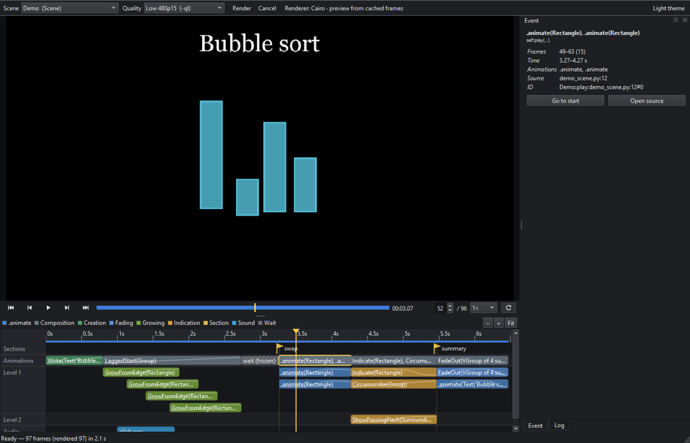

# manim-stage

Motion Canvas–class authoring for [Manim Community Edition](https://github.com/ManimCommunity/manim): a desktop Studio editor written in Python, a seekable timeline that understands Manim's animations, export through Manim's own CLI, and (coming next) named timing cues for narration, an audio workspace and code-diff animations. It is an **optional Python layer on top of Manim**, not a fork and not a new renderer. Manim's terms and concepts are kept throughout (see [ADR-0013](docs/architecture-decisions.md)).



> **Status: 0.1.0.** All four milestones are complete ([M1](docs/m1-gate-report.md), [M2](docs/m2-gate-report.md), [M3](docs/m3-gate-report.md), [M4](docs/m4-gate-report.md) gate reports; [CHANGELOG](CHANGELOG.md)).
> - Examples: [narrated bubble sort](examples/bubble_sort/), [themed lesson series](examples/lesson_series/), [algorithm gallery](examples/algorithms/), [third-party-style examples](examples/third_party/).
> - Coming from plain Manim or Motion Canvas? Read the [migration guide](docs/migration-guide.md). To install a release, see [docs/release.md](docs/release.md).
>
> - Spec: [`spec.md`](spec.md)
> - Knowledge base: [`docs/kb/`](docs/kb/README.md)
> - How Motion Canvas features are ported: [`PORTING.md`](PORTING.md)
> - Decisions: [`docs/architecture-decisions.md`](docs/architecture-decisions.md)
> - Plan: [`docs/backlog.md`](docs/backlog.md)

## Quick start

manim-stage needs the Manim 0.30 line, which is unreleased, so it pins a reviewed Manim commit:

```bash
git clone https://github.com/sethstenzel/manim-stage && cd manim-stage
uv sync                                    # Python env with the pinned Manim + the editor
uv run manim-stage doctor                  # check Manim, Cairo, fonts, LaTeX, FFmpeg, Qt
uv run manim-stage studio path/to/lesson.py  # open the Studio editor
```

Without uv: `pip install "manim-stage[studio] @ ." "manim @ git+https://github.com/ManimCommunity/manim@<commit from upstreams.json>"`.

Other commands, all documented in the [CLI page](docs/kb/manim-stage/cli.md):
- `manim-stage scenes FILE`
- `manim-stage timeline FILE SCENE [--json]`
- `manim-stage cache [--clear]`

Your scenes stay plain Manim, and `manim render` keeps working unchanged.

## Relationship to upstream projects

| Project | Role | How it is used |
|---|---|---|
| [ManimCommunity/manim](https://github.com/ManimCommunity/manim) | **Dependency** | Pinned to a reviewed commit. It stays the authoritative engine, scene model and renderer. Not vendored, not forked. |
| [motion-canvas/motion-canvas](https://github.com/motion-canvas/motion-canvas) | **Reference** | Behaviour and UX reference only. No source or UI assets are copied. Concepts are re-implemented in Python on Manim primitives ([`PORTING.md`](PORTING.md)). |

Both are pinned to reviewed commits in [`upstreams.json`](upstreams.json). [`docs/upstream-sync.md`](docs/upstream-sync.md) explains how new upstream changes are reviewed and brought in. [ADR-0001](docs/architecture-decisions.md) explains why this is a standalone repo rather than a GitHub fork.

```bash
python scripts/upstream_sync.py status     # what changed upstream since our pins
```

## License

MIT; see [LICENSE](LICENSE) and [NOTICE](NOTICE). The optional editor uses PySide6 (LGPLv3) as an unmodified dynamic dependency.
