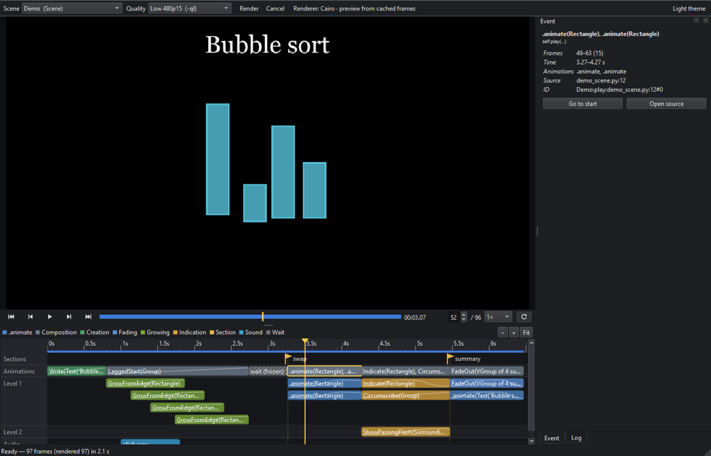

# manim-stage

Motion Canvas-class authoring for [Manim Community Edition](https://github.com/ManimCommunity/manim). It's an **optional Python layer on top of Manim**, not a fork or a new renderer:

- **The Studio:** a desktop editor written in Python. Manim draws its viewport.
- **A seekable timeline** that understands Manim's animations.
- **Named cues** for narration, an audio workspace, and code-diff animations.
- **Export** through Manim's own CLI.

Manim's terms and concepts are kept throughout.



## Start here

| I want to… | Go to |
|---|---|
| Install manim-stage | [Installing and releasing](release.md) |
| Open my existing Manim scenes in the editor | [Migration guide → from Manim](migration-guide.md#from-manim) |
| Move over from Motion Canvas | [Migration guide → from Motion Canvas](migration-guide.md#from-motion-canvas) |
| Build a narrated lesson end to end | [Tutorial: narrated bubble sort](kb/tutorials/narrated-bubble-sort.md) |
| Find a feature and how to use it | [Knowledge base](kb/README.md) |
| See what changed | [What's new](kb/whats-new.md) and the [Changelog](changelog.md) |
| Know how Motion Canvas features were ported to Manim | [How Motion Canvas was ported](porting.md) |

## Quick start

```bash
git clone https://github.com/sethstenzel/manim-stage && cd manim-stage
uv sync                                       # Python env with the pinned Manim and the editor
uv run manim-stage doctor                     # check Manim, Cairo, fonts, LaTeX, FFmpeg, Qt
uv run manim-stage studio examples/bubble_sort/lesson.py
```

## About these docs

- **Rebuilt automatically.** This site is generated from the Markdown in the repository on every change to `main`, and each release has a copy attached.
- **Examples are tested.** Every `python` example in the knowledge base runs in CI, unless the page marks it as a fragment.
- **Status labels are honest.** Each feature page says whether a feature is Available, Partial or Planned, and which renderer it's tested with.
