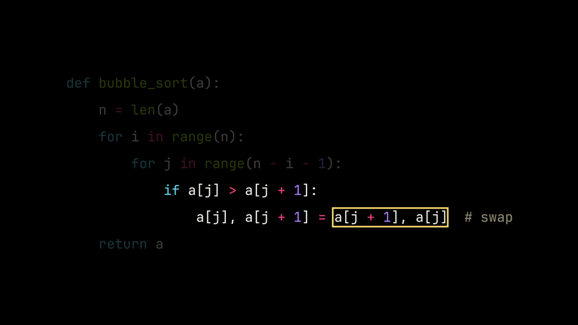
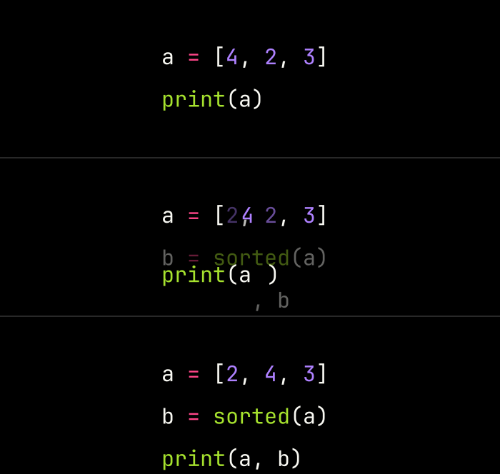

# AnimatedCode

- **Status:** Available: layout, tokens, ranges, highlighting, selection boxes, and animated edits between versions (`animate_to`, `insert`, `remove`, `replace`).
- **Renderer:** Cairo (OpenGL untested)
- **Since:** PR #23 (edits: PR #24)
- **Spec:** F05 · **Backlog:** 2.5, 2.6 · **ADRs:** ADR-0008, ADR-0013 · **Source:** `src/manim_stage/code.py`
- **Motion Canvas origin:** the `Code` node, with `lines()`, `word()`, `findFirstRange()`/`findAllRanges()`, selections that dim everything else, and code edits that tween token by token. **Built on:** Manim `VGroup`/`MarkupText` (Pango), Pygments, and a bundled JetBrains Mono font.



## What it is

`AnimatedCode` shows source code as Manim mobjects, built for teaching:
- every **token** (keyword, name, operator…) is its own `VGroup` of glyphs, so any Manim animation works on a line, a word or a single token;
- you can address code the way you talk about it: "line 5", "the word `swap`", "every `range`".

`manim.Code` is unchanged and still available. Use `AnimatedCode` when the code itself is animated.

## Quick start

```python
from manim import *
from manim_stage import AnimatedCode

SRC = '''def bubble_sort(a):
    n = len(a)
    for i in range(n):
        for j in range(n - i - 1):
            if a[j] > a[j + 1]:
                a[j], a[j + 1] = a[j + 1], a[j]  # swap
    return a
'''

class Walkthrough(Scene):
    def construct(self):
        code = AnimatedCode(SRC, language="python", style="monokai", font_size=24)
        self.play(FadeIn(code))
        self.play(code.highlight_lines(5, 6))                     # dim everything else
        box = code.surround(code.find("a[j + 1], a[j]"), color=YELLOW)
        self.play(Create(box))
        self.play(Indicate(code.get(code.find("swap"))))          # any Manim animation
        self.play(code.reset_highlight(), FadeOut(box))

with tempconfig({"frame_rate": 10, "dry_run": True}):
    Walkthrough().render()
```

## Animated edits



```python
from manim import *
from manim_stage import AnimatedCode

class Edits(Scene):
    def construct(self):
        code = AnimatedCode("a = [4, 2, 3]\nprint(a)\n")
        self.add(code)
        self.play(code.animate_to("a = [2, 4, 3]\nb = sorted(a)\nprint(a, b)\n"), run_time=1)
        self.play(code.highlight_lines(2))
        self.play(code.replace(code.find("sorted"), "reversed"))      # targeted edit
        self.play(code.insert(*code.find(")").start, ", key=abs"))    # insert before ")"
        self.play(code.remove(code.find(", b")))
        assert code.source == "a = [2, 4, 3]\nb = reversed(a, key=abs)\nprint(a)\n"

with tempconfig({"frame_rate": 10, "dry_run": True, "disable_caching": True}):
    Edits().render()
```

- **`code.animate_to(new_source, *, mapping=None, lag_ratio=0)`** returns a Manim animation:
  - tokens that are the same token in both versions **slide** to their new place (and re-colour if their highlighting changed);
  - removed tokens **fade out**, new tokens **fade in**;
  - when it ends, the `AnimatedCode` *is* the new code, so later `find`, `highlight` and `animate_to` calls work on the new version.
- **`replace(range, text)`, `insert(line, col, text)`, `remove(range)`** compute the new source for you. They pin every token outside the range to itself, so only the edited part can change.
- **Unchanged lines don't move.** The new version is laid out on the same character grid as the old one (the grid anchors), so a token whose position didn't change stays pixel-exact.
- **Highlights survive edits.** Kept tokens keep their current dim/highlight level.
- **`lag_ratio`** staggers the tokens in reading order (0: all together, as in Motion Canvas).

### How tokens are matched (`manim_stage.code_diff`)

1. **Patience diff on lines.** Lines that occur once in each version anchor the alignment, so a common `}` or `return` doesn't pull unrelated blocks together. The rest is aligned by LCS.
2. **Equal lines** keep all their tokens.
3. **Moved lines.** A non-blank line removed in one place and added elsewhere with the same text slides as a whole (Motion Canvas would fade it).
4. **Changed lines** are matched token by token (LCS on token text), so `a = 1` → `a = 2` keeps `a` and `=`.
5. **Overrides.** `mapping={old_token_index: new_token_index}` pins pairs; `None` forces a fade-out. Indices are positions in `code.tokens` and the new code's tokens.
6. **Ambiguity.** When a repeated token (e.g. two `a`s) changed position, the animation's `diff.warnings` says so and suggests `mapping=`.

```python
from manim_stage.code import tokenize
from manim_stage.code_diff import diff_tokens

d = diff_tokens(tokenize("swap(a, a)\n"), tokenize("swap(b, a, a)\n"))
print(d.warnings)   # ["token 'a' repeats (2x) where code changed …; pass mapping= …"]
```

## How it works

**Tokens:**
- Pygments lexes the source in any language it knows: Python, JavaScript/TypeScript, Rust, C/C++, Go, Bash, SQL and hundreds more.
- Each token keeps its line, column, text, Pygments type, and the style's colour, bold and italic (`style=` is any Pygments style).
- Whitespace is layout, not a token. Tabs are expanded (`tab_width=4`).

**Glyphs:**
- Each line is one Pango call (`MarkupText` with coloured spans), so it's fast.
- Every glyph is placed on an explicit **character grid** (line, column). A full-block marker glyph gives each line the exact position of column 0 and its baseline; the marker is then removed.
- The default font is **JetBrains Mono** (OFL, bundled), so code lays out the same on Windows, Linux and macOS. Use `font=` to pick another monospace font.

**Grid anchors:**
- Two invisible points in the group track the grid's origin and one cell step, so `code.grid_point(line, col)` stays correct after you `shift`, `scale` or `rotate` the code.
- This is what lets an edited version lay out on the same grid, so unchanged code doesn't jump (2.6).

**Coordinates are 1-based**, as editors show them (Ln 3, Col 5).

## API

| Call | Returns | Motion Canvas analogue |
|---|---|---|
| `AnimatedCode(source, language="python", *, style="monokai", font=…, font_size=24, line_spacing=1.5, tab_width=4)` | the mobject | `<Code code={…}/>` |
| `code.lines(first, last=None)` | `CodeRange` of whole lines | `lines(from, to)` |
| `code.word(line, col, length)` | `CodeRange` | `word(line, col, length)` |
| `code.find(text, nth=0)` / `code.find_all(text)` | `CodeRange` / list | `findFirstRange` / `findAllRanges` |
| `code.get(range_or_ranges)` | `VGroup` of the glyphs (use with any animation) | — |
| `code.get_line(n)` | `VGroup` | — |
| `code.highlight(ranges, dim_opacity=0.25)` / `code.highlight_lines(*n)` | animation dimming everything else | `selection(...)` |
| `code.reset_highlight()` | animation | `selection(DEFAULT)` |
| `code.surround(range, buff=0.06, **kw)` | `SurroundingRectangle` | selection box |
| `code.tokens`, `code.token_mobjects` | parallel lists | — |
| `code.grid_point(line, col)` | scene point of a cell's top-left | — |
| `code.animate_to(src, mapping=, lag_ratio=)` | `CodeEdit` animation (`.diff` holds matches, moves, warnings) | `code(src, duration)` / `edit` |
| `code.replace(range, text)` / `insert(line, col, text)` / `remove(range)` | `CodeEdit` | `replace` / `insert` / `remove` |

## Limitations and unsupported cases

- **Performance:** all not-yet-seen lines of a code version are laid out in **one** Pango call. That costs about 3 s cold on Windows and much less on Linux and macOS. Laid-out lines are cached, so edits only lay out changed lines. Diffing is fast (600 lines in well under a second).
- **Ligatures** are switched off (`liga`/`calt`) so every character is one glyph. Code shows `==`, not a merged symbol.
- **Fonts:** a non-monospace `font=` breaks the grid; use a monospace font.
- **Unicode:** characters that Pango renders as several glyphs (rare combining sequences) can upset the token-to-glyph split. Common accented letters and Greek work.
- **No background panel or line numbers yet.** Add a `SurroundingRectangle` behind the code if you need one.

## Related

- [Timeline](timeline.md), [Named cues](cues.md), [Motion Canvas equivalents](../reference/motion-canvas-equivalents.md).
