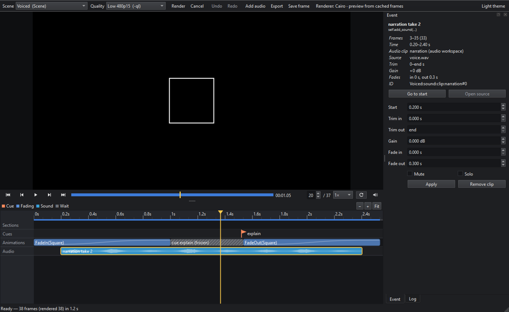

# Audio workspace

- **Status:** Available.
  - **Clips:** import, drag, trim, gain, fades, mute and solo, with undo, plus waveforms.
  - **Playback:** synced to the playhead; the preview mixdown is the render mixdown.
  - **Planned:** the voiceover adapter (2.4).
- **Renderer:** Both (audio only)
- **Since:** PR #20 (editing: PR #21)
- **Spec:** F04 · **Backlog:** 2.3 · **Source:** `src/manim_stage/audio.py`, `scene.py` (`StageMixin.setup`), `studio/audio_player.py`
- **Motion Canvas origin:** the project's audio track: one file, an offset, and a waveform under the timeline. **Built on:** Manim's `Scene.add_sound(file, time_offset, gain)` and Manim's own audio mixer, with PyAV for decoding.



## What it is

Manim already mixes sounds you add with `self.add_sound(...)`. The audio workspace adds what narrated lessons need:
- clips that you place, trim, fade, mute or solo **without touching your Python code or the original recordings**;
- a waveform on the timeline;
- sound in the preview, in sync with the playhead.

## Quick start

```python
from pathlib import Path

import numpy as np

from manim_stage import audio
from manim_stage.capture import capture

Path("voice_lesson.py").write_text('''
from manim import *
from manim_stage import StageScene

class Voiced(StageScene):
    def construct(self):
        self.play(FadeIn(Square()), run_time=1)
        self.cue("explain", at=1.5)
        self.play(FadeOut(Square()), run_time=1)
''')
t = np.arange(48000) / 48000
audio.write_wav("voice.wav", np.stack([np.sin(2 * np.pi * 220 * t)] * 2, 1).astype(np.float32) * 0.3)

clips = audio.AudioFile({"Voiced": [
    audio.AudioClip("narration", "voice.wav", start=0.5, trim_in=0.1, gain_db=-3, fade_out=0.2),
]})
audio.save(".manim-stage/audio.json", clips)

import importlib.util
spec = importlib.util.spec_from_file_location("voice_lesson", "voice_lesson.py")
mod = importlib.util.module_from_spec(spec); spec.loader.exec_module(mod)
with __import__("manim").tempconfig({"frame_rate": 15, "dry_run": True}):
    tl = capture(mod.Voiced)
sound = next(e for e in tl.events if e.kind == "sound")
print(sound.label, sound.start_frame, sound.meta["clip"])   # voice.wav 7 narration
```

Then `manim render voice_lesson.py Voiced` renders the clip into the video exactly as the Studio previews it.

## Editing clips in the Studio

- **Add audio…** (toolbar, Ctrl+Shift+A) adds a file at the playhead. A file outside the project is copied into `assets/audio/` first, so `audio.json` only holds portable project-relative paths. Same name with different content gets a `-1` suffix.
- **Drag a clip** on the Audio lane:
  - drag the body to move it;
  - drag the left edge to trim the start (the audio stays in place);
  - drag the right edge to trim the end, back to "end of file" at most.
  - A dashed outline and the change in seconds preview the drag.
- **Event panel** (select a clip): start, trim in/out, gain (dB), fade in/out, Mute, Solo, **Apply**, **Remove clip**.
- **Muted (or not-soloed) clips stay on the timeline**, hatched and labelled `(muted)`, so you can unmute them. They are left out of the render.
- **Undo:** every change is one undo step (Ctrl+Z / Ctrl+Shift+Z). It writes `audio.json` atomically and re-renders.

## How it works

- **Clips** live in `.manim-stage/audio.json`, next to `cues.json` (schema: `docs/schemas/audio.schema.json`). Each clip has:
  - `file`: project-relative;
  - `start`: seconds from the scene start, may be negative to cut the beginning;
  - `trim_in` / `trim_out`: seconds into the source;
  - `gain_db`, `fade_in`, `fade_out`;
  - `mute`, `solo`, and a `label`.
- **Non-destructive:**
  - When a [StageScene](cues.md) starts (`setup()`), each active clip is decoded, trimmed, gained and faded into a cached WAV under `.manim-stage/cache/audio/`, named by the source's content and the settings. It is then added with Manim's own `add_sound(copy, time_offset=start)`.
  - Your recording is never changed.
  - Plain `manim render` does the same, so headless renders include the clips.
- **Mute / solo:** muted clips are left out. If any clip is soloed, only soloed clips play.
- **Preview mixdown:** the editor mixes exactly the sounds the timeline reports, both your code's `add_sound` calls and clips, at their start times and gains. What you hear is what Manim renders. A test compares the exported AAC track with the preview mix: placement within one frame, correlation > 0.98, level within 10%.
- **Playback:**
  - **Sync:** it follows the playhead and re-syncs if it drifts by more than about a frame.
  - **Silent while:** frames are still rendering (buffering), playback speed isn't 1×, or the speaker button is off.
  - **Library:** it uses `sounddevice`. Without an output device, PortAudio, or with `MANIM_STAGE_NO_AUDIO=1`, the preview is silent; the button is disabled and its tooltip gives the reason.
- **Waveforms** are computed in the background (100 peaks per second, cached by content) and drawn on the Audio lane.
- **Event panel:** clip, source file, trim, gain and fades.
- **Decoding:** everything is decoded by PyAV to 48 kHz stereo, so WAV, MP3, OGG and FLAC all work. Mono sources are spread to stereo at −3 dB, the same as Manim.

## Options

| Clip field | Default | Meaning |
|---|---|---|
| `start` | 0 | Scene time (s) at which the trimmed clip starts |
| `trim_in` / `trim_out` | 0 / end | Part of the source file to use (s) |
| `gain_db` | 0 | Volume change in dB |
| `fade_in` / `fade_out` | 0 | Linear fade lengths (s) |
| `mute` / `solo` | false | Leave out / play only soloed clips |
| `label` | file name | Name shown on the timeline |

## Limitations and unsupported cases

- Clips from code (`self.add_sound(...)` in your scene) are shown with waveforms but are read-only; change them in Python.
- **Plain StageScene only.** Clips are added in `StageMixin.setup()`. If you override `setup()`, call `super().setup()`.
- **Ducking.** `gain_to_background` on code `add_sound` calls is applied by Manim at render time but not in the preview mix.
- **Captions and word timings** come with the voiceover adapter (2.4).

## Related

- [Named cues](cues.md) (align animation to narration), [Timeline](timeline.md), [Export](export.md), [Sound and sections in Manim](../manim/sound-and-sections.md).
