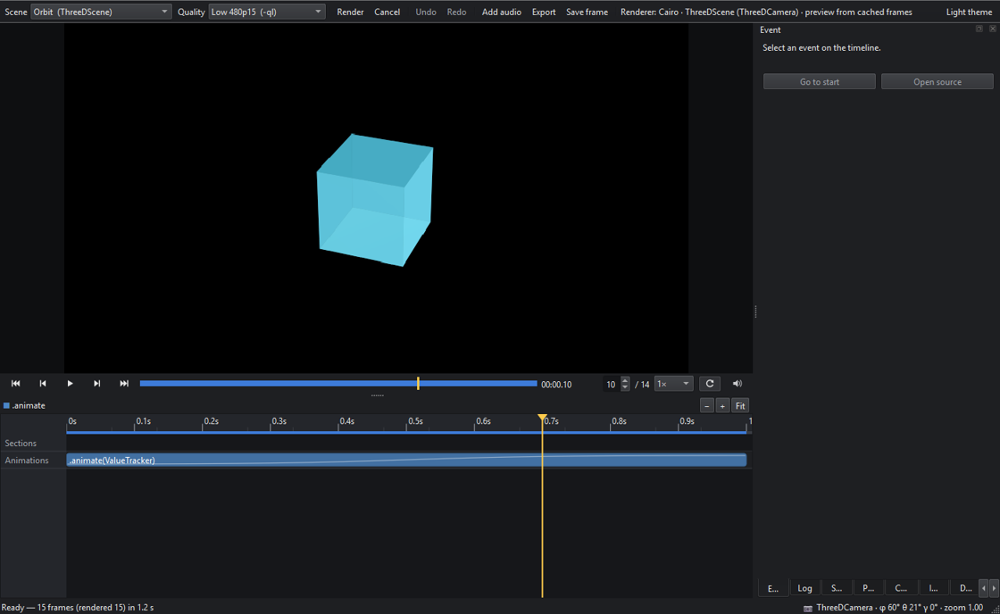

# Camera-aware preview

- **Status:** Available
- **Since:** PR #37
- **Backlog:** MF.8 · **Spec:** §2.7 · **Source:** `src/manim_stage/camera_info.py`, `studio/ui/viewport.py`, `runner.py`, `framecache.py`
- **Built on:**
  - Manim's camera frame (`self.camera.frame`, animatable in every scene);
  - `ThreeDCamera` (φ θ γ, zoom, focal distance);
  - `ZoomedScene`'s zoomed camera.



## What it is

The Studio knows where the camera is in every frame.

| Part | What it shows |
|---|---|
| **Camera readout** (status bar, right) | Only when the camera isn't the default. A moved or zoomed frame shows `center (x, y) · width w (k×)`. `ThreeDCamera` shows `φ θ γ · zoom`. `ZoomedScene` also shows the zoomed camera's centre and width. Hover for the full state. |
| **Clicks and selection boxes** | Map through a moved camera frame, so clicking a Mobject and the [inspector](inspector.md)'s selection outline stay correct after `self.camera.frame.animate.scale(0.5).move_to(...)`. |
| **Renderer badge** (toolbar) | The preview renderer (always Cairo), the scene type and its camera, for example `ThreeDScene (ThreeDCamera)`. It adds `exports: OpenGL` when `manim.cfg` sets `renderer = opengl`. The preview never substitutes a renderer without saying so. |

## Quick start

```python no-run
class Pan(Scene):
    def construct(self):
        self.add(Square(), Dot(RIGHT * 2))
        self.play(self.camera.frame.animate.scale(0.5).move_to(RIGHT * 2))
```

Run `manim-stage studio pan.py Pan` and scrub: the status bar reads `📷 Camera · center (2.00, 0.00) · width 7.11 (2.00×)`.

## How it works

- **The state is recorded as each frame renders.** The preview runner stores it in the cached PNG as a text chunk (`manim_stage.camera`), so frames served from the cache keep it.
- **The viewport reads it** from the image it is about to show; the preview protocol is unchanged.
- **Pixels are unaffected.** The chunk is metadata only.

## Limitations and unsupported cases

- **3D clicks and selection boxes** use the flat default mapping: the inspector's bounds are scene coordinates, not projected.
- **The zoomed display** (the picture-in-picture inset) isn't mapped for clicks.

## Related

- [Inspector](inspector.md), [Studio editor](studio-editor.md), [Config](config.md).
