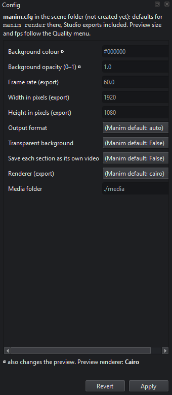

# Manim config (`manim.cfg`) in the Studio

- **Status:** Available
- **Since:** PR #36
- **Backlog:** MF.6 · **Spec:** F10 · **Source:** `src/manim_stage/manimcfg.py`, `studio/ui/config_panel.py`
- **Built on:** Manim's own `manim.cfg` `[CLI]` section, so plain `manim render`, Studio previews and Studio exports read the same file.



## What it is

The **Config** tab edits the `[CLI]` section of `manim.cfg` in the scene's folder: the defaults Manim uses for every render there.

| Key | Changes the preview? |
|---|---|
| `background_color`, `background_opacity` | Yes (◐) |
| `frame_rate`, `pixel_width`, `pixel_height` | No. Exports use them unless a preset or quality overrides them; the preview follows the **Quality** menu. |
| `format` (mp4/mov/webm/gif/png), `transparent`, `save_sections` | No (export) |
| `renderer` (cairo/opengl) | No. The preview is always Cairo and says so; exports use the chosen renderer. |
| `media_dir` | No |

## Quick start

1. Open the **Config** tab. Empty fields show Manim's default as a placeholder.
2. Type a value (for example background `#1E1E2E`), then press **Apply**.
3. `manim.cfg` is created or updated, and the preview re-renders. Undo (Ctrl+Z) restores the previous file.

The file is plain Manim:

```ini
[CLI]
background_color = #1E1E2E
format = mp4
```

## How it works

- **Only the edited keys change.** Other keys in `[CLI]`, other sections (such as `[logger]`) and their order are kept. A `.bak` copy of the old file is written. Clearing a field removes the key.
- **Values are checked before writing:** colours, positive sizes, opacity 0–1, `True`/`False`, known formats and renderers.
- **`manim.cfg` is a render dependency.** Editing it, here or in a text editor, re-renders the preview.

## Limitations and unsupported cases

- **Only the folder's `manim.cfg` is edited.** The user-wide config file and `--config_file` aren't.
- **Less common keys** (`zero_pad`, `write_all`…) aren't shown, but they're kept when you save.

## Related

- [Export](export.md) (presets and quality override size and fps), [Sections](sections.md), [Studio editor](studio-editor.md).
