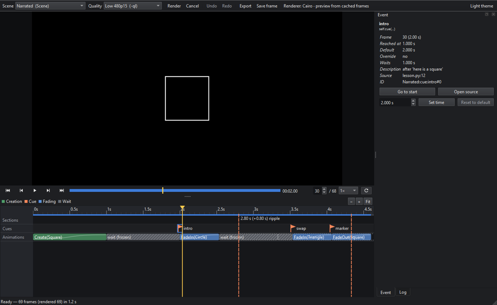

# Named cues (`self.cue`)

- **Status:** Available: API, sidecar, validate, bake, and dragging on the timeline with hold/ripple and undo/redo.
- **Renderer:** Both (pure timing; no drawing)
- **Since:** PR #18 (timeline editing: PR #19)
- **Spec:** F03 · **Backlog:** 2.1 · **ADRs:** ADR-0006, ADR-0013 · **Source:** `src/manim_stage/scene.py`, `cues.py`, `cuetools.py`
- **Motion Canvas origin:** `waitUntil("name")` time events, whose times are dragged on the timeline and stored in a `.meta` file. **Built on:** Manim's `Scene.wait`. A cue *is* a wait whose end time has a name and can be edited.

## What it is

When you narrate a lesson, animations should start when the voice says something, not after hand-tuned `self.wait(1.7)` calls. A cue is a named wait. `self.cue("explain_swap", at=4.0)` waits until 4 s into the scene, unless you move `explain_swap` later or earlier (on the Studio timeline, or in `.manim-stage/cues.json`). Python still decides the *order* of things; the sidecar only decides *when*. Replace the narration with a longer take, nudge five cues, and nothing in your code changes.

## Quick start

```python
from manim import *
from manim_stage import StageScene
from manim_stage.capture import capture

class BubbleSort(StageScene):
    def construct(self):
        bars = VGroup(*[Rectangle(height=h, width=0.5) for h in (3, 1, 2)]).arrange(RIGHT)
        self.play(Create(bars), run_time=1)
        self.cue("introduce_array", at=2.0, description="'here is our array'")
        self.play(bars[0].animate.shift(RIGHT), run_time=0.5)
        self.cue("explain_swap", after=1.5)
        self.play(Indicate(bars[1]), run_time=0.5)

with tempconfig({"frame_rate": 10, "dry_run": True}):
    tl = capture(BubbleSort)
for e in tl.events:
    if e.kind == "cue":
        print(e.label, e.start_frame / 10, "s")   # introduce_array 2.0 s / explain_swap 4.0 s
```

Use it in any kind of Manim scene with the mixin:

```python no-run
from manim import MovingCameraScene
from manim_stage import StageMixin

class CameraLesson(StageMixin, MovingCameraScene):
    def construct(self):
        self.cue("zoom_in", at=1.0)
        self.play(self.camera.frame.animate.scale(0.5))
```

## How it works

**`self.cue(name, *, at=None, after=None, description=None)`** waits until the cue's target time:

| You write | Default target |
|---|---|
| `cue("x", at=4.0)` | 4 s from the scene start |
| `cue("x", after=1.5)` | 1.5 s after this call (exactly like `self.wait(1.5)`) |
| `cue("x")` | Now: a marker that waits 0 s until you move it |

**Overrides** live in `.manim-stage/cues.json`, found in the nearest folder at or above the scene file that has a `.manim-stage/` folder (else next to the scene). An override replaces the default target:

```json
{
  "schema": "manim_stage.cues", "version": 1, "frame_rate": 30,
  "scenes": {
    "BubbleSort": {"cues": {
      "introduce_array": {"target_frame": 75, "description": "'here is our array'"},
      "old_name": {"target_frame": 120, "tombstone": true}
    }}
  }
}
```

- **Time model.** Targets are absolute frames from the scene start, at the file's `frame_rate`. At another render frame rate they are rescaled to the nearest frame, which is accurate to one frame (spec §9). See [data formats](../reference/data-formats.md).
- **One resolver everywhere.** The Studio preview, `manim render`, `manim-stage validate` and `manim-stage bake` all resolve cues the same way. Plain `manim render lesson.py BubbleSort` reads the sidecar too, so headless renders match the preview.
- **Writes are atomic.** The file is written to a temporary file and then renamed, and the previous version is kept as `cues.json.bak`. A corrupt file falls back to the backup, or fails loudly; cues are never silently dropped.
- **Timeline.** Cues have their own **Cues** lane. The `wait` a cue issued is labelled `cue <name>` and points at your `cue(...)` line. The Event panel shows when the cue was reached, its default, its override and how long it waits.
- **IDs.** Cues are identified by name (`Scene:cue:name#0`), so moving the call in your code keeps its timing.

**Validation:**

| Problem | Result |
|---|---|
| Target earlier than the moment the cue is reached (a negative wait) | **Error.** The render fails at your `cue(...)` line, saying whether the default or the override is at fault. |
| The same name reached twice in one run (e.g. in a loop) | **Error.** Use `cue(f"step_{i}")`. |
| Invalid name, `at=` with `after=`, or a negative time | **Error** |
| An override for a cue the scene no longer reaches (renamed/removed) | **Warning.** The override is kept (and marked a tombstone by `bake`) until you remove it. |

## Editing cues in the Studio



- **Drag** a cue flag on the **Cues** lane. While you drag, dashed lines show where the cues will land, and outlines show the animations that shift with them. A label gives the new time and the change, e.g. `2.80 s (+0.80 s)`.
- **Hold (default).** Other cues keep their absolute times. Animations between this cue and the next one move, and the next cue's wait absorbs the change. You can't drag past the point where the next cue would need a negative wait; the label says why the drag stopped.
- **Ripple (hold Shift while dragging).** Every later cue moves by the same amount, so the rest of the scene shifts as a block. Use this after replacing a narration take that is longer overall.
- **You can never drag a cue earlier than where it is reached** in the code.
- **Dropping** writes `.manim-stage/cues.json` atomically and re-renders straight away; the file watcher doesn't render it a second time.
- **Undo / redo:** Ctrl+Z, and Ctrl+Shift+Z or Ctrl+Y (also in the toolbar). Each drag, nudge or reset is one step, and undoing restores the exact previous sidecar values, including "no override".
- **Keyboard:** select a cue, then Alt+Shift+←/→ nudges it one frame; add Ctrl to ripple.
- **Event panel:** type an exact time and press **Set time**, or **Reset to default** to remove the override.

## Command line

```bash
manim-stage validate lesson.py            # every StageScene: cues, overrides, errors, orphans (exit 1 on errors)
manim-stage validate lesson.py BubbleSort
manim-stage bake lesson.py                # write every resolved target into cues.json; orphans become tombstones
```

`bake` pins the current timing, so later edits to `at=`/`after=` defaults don't move a narration-locked cue.

## Limitations and unsupported cases

- **The undo history is per editor session.** The sidecar itself keeps only the previous version (`cues.json.bak`).
- **Fixed order.** Cues are reached in code order; a cue can't be moved before the moment it's reached. That is the negative-wait error, by design.
- **Audio alignment.** Linking a cue to a narration segment (`audio_segment`) is stored but not yet used. That comes with the audio workspace (2.3) and the voiceover adapter (2.4).

## Related

- [Timeline](timeline.md), [CLI](cli.md), [Data formats](../reference/data-formats.md), [Motion Canvas equivalents](../reference/motion-canvas-equivalents.md).
