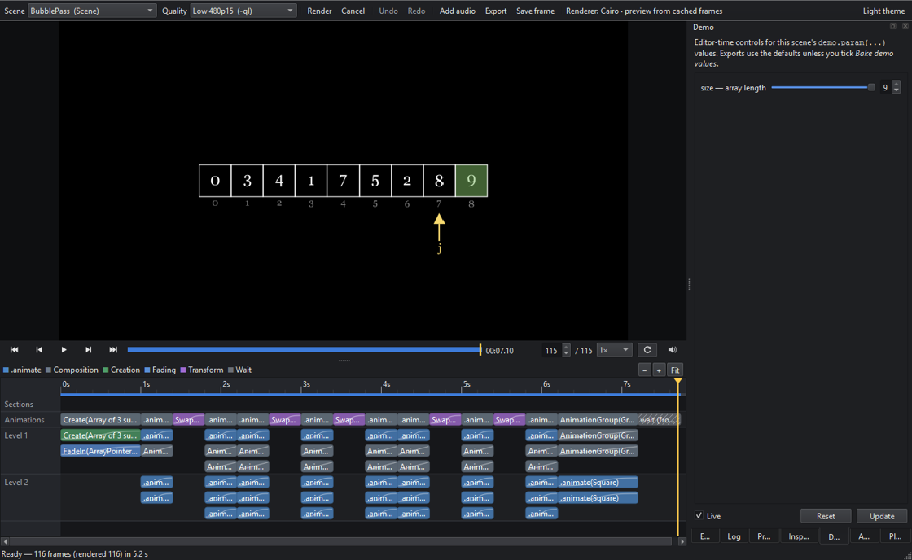

# Demo parameters (editor-time interactivity)

- **Status:** Available
- **Since:** PR #34
- **Spec:** F12 · **Backlog:** 4.3 · **Source:** `src/manim_stage/demo.py`, `studio/ui/demo_panel.py`
- **Motion Canvas origin:** none directly; MC scenes read project variables. **Built on:** the [project variable](project.md) types and validation, and the preview service's override files (like the [inspector](inspector.md)).



## What it is

Knobs for exploring a scene while you build or present it: array size, speed, which algorithm, a colour, a toggle. The Studio's **Demo** tab shows one control per parameter, and moving it re-renders the preview.

Demo values are **editor-time only**:
- nothing is saved;
- an export is a linear video rendered with the **defaults**, unless you tick **Bake demo values** in the Export dialog.

For settings that should be saved and always apply, use [project variables](project.md).

## Quick start

```python
from manim import *
from manim_stage import demo

class Sort(Scene):
    def construct(self):
        n = demo.param("n", 6, min=2, max=12, description="array length")
        speed = demo.param("speed", 1.0, min=0.25, max=4.0, step=0.25)
        algo = demo.param("algorithm", "bubble", options=["bubble", "insertion"])
        show_indices = demo.param("indices", True)
        ...
```

Run `manim-stage studio sort.py Sort` and open the **Demo** tab.

## Controls

| Parameter | Control |
|---|---|
| Number or integer with `min` and `max` | Slider and spin box (`step` sets the spin increment) |
| Unbounded number or integer | Spin box |
| `True` / `False` | Check box |
| `options=[...]` | Drop-down list |
| `"#RRGGBB"` | Colour button |
| Text | Text field (applies on Enter) |

- **Live** (on by default) re-renders about 250 ms after you stop moving a control. Turn it off and press **Update** to apply several changes at once.
- **Reset** returns every parameter to its default.

## How it works

- `demo.param` returns the default, unless `MANIM_STAGE_DEMO` names a JSON file of overrides. The Studio writes that file into its cache folder.
- Values are validated like project variables (type, range, options). A bad value is an error that names the parameter.
- The runner reports the parameters each render read, and the Demo tab builds its controls from that list.
- The override file is a render dependency, so each combination of values caches its own frames. Returning to earlier values is instant.
- Plain `manim render` never sets `MANIM_STAGE_DEMO`, so it always renders the defaults.

## Limitations and unsupported cases

- **Not a live runtime.** Each change re-runs the scene in the preview service. Long scenes take as long to re-render as any edit.
- **The web player can't change parameters.** It plays a rendered video ([web player](web-player.md)); render one video per variant if you need several.

## Related

- [Project theme and variables](project.md), [Export](export.md#demo-parameters), [Web player](web-player.md).
