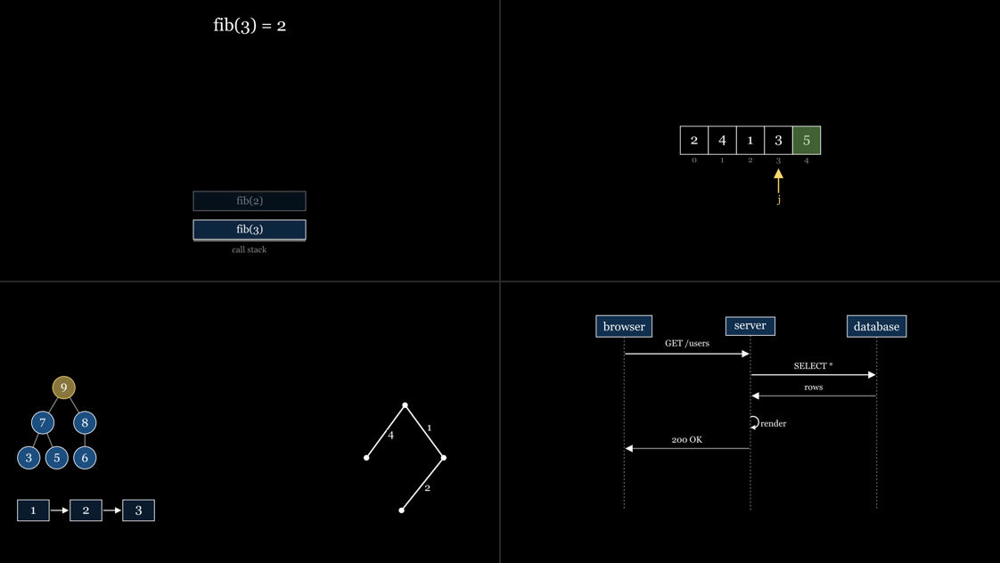

# Educational helpers (data structures, call stacks, protocols, traces)

- **Status:** Available
- **Since:** PR #33
- **Spec:** F12 · **Backlog:** 4.2 · **Source:** `src/manim_stage/edu.py`; example: `examples/algorithms/gallery.py`
- **Motion Canvas origin:** none directly. MC users build these by hand from nodes. **Built on:** Manim `VGroup`, `Graph`, `Swap`, `Transform`, `FadeIn`/`FadeOut`, `GrowArrow`.



## What it is

Ready-made Mobjects for computer-science lessons. Each one is an ordinary Manim `VGroup`. Its methods update the model and **return an animation** that you `self.play(...)`, so:
- they render with plain `manim render`;
- they appear on the Studio [timeline](timeline.md) like any other animation;
- they compose with cues, signals and flow helpers.

| Helper | What | Methods returning animations |
|---|---|---|
| `Array(values)` | Boxed values with index labels | `swap(i, j)`, `set_value(i, v)`, `highlight(i or [i, j], color, opacity)`; `pointer(i, "j")` → `ArrayPointer.move_to_index(k)` |
| `LinkedList(values)` | Nodes joined by arrows | `append(v)`, `highlight(i)` |
| `Tree(children, root, labels=)`, `Tree.from_heap(values)` | Rooted tree with tidy layout | `highlight(key)`; `nodes[key]`, `edges[(parent, child)]` |
| `tree_layout(children, root)` | Positions dict for **Manim's own `Graph`** | `Graph(..., layout=tree_layout(...))` |
| `label_edges(graph, {(u, v): w})` | Weights or labels that follow a Manim `Graph`'s edges | a `VGroup` to `FadeIn` |
| `CallStack()` | Frames growing upward | `push(label)`, `pop()`, `trace_handlers()` |
| `SequenceDiagram(participants)` | Lifelines; one row per message | `message(src, dst, label, reply=False)` (self-messages allowed) |
| `Trace`, `trace_calls`, `play_trace` | Data-driven execution traces | see below |

## Quick start

```python
from manim import *
from manim_stage.edu import Array, CallStack, play_trace, trace_calls

def fib(n):
    return n if n < 2 else fib(n - 1) + fib(n - 2)

class Lesson(Scene):
    def construct(self):
        arr = Array([5, 2, 4])
        j = arr.pointer(0, "j")
        self.play(Create(arr), FadeIn(j))
        self.play(arr.swap(0, 1), j.move_to_index(1))

        result, trace = trace_calls(fib, 3)      # runs fib now, records calls/returns
        stack = CallStack().to_edge(DOWN)
        self.play(FadeIn(stack))
        play_trace(self, trace, stack.trace_handlers(), run_time=0.3)
```

## Traces: record first, animate second

The spec requires traces to be produced by a **trusted Python function** and then animated. Nothing runs live inside the viewer.

- **Record calls automatically:** `result, trace = trace_calls(func, *args)`.
  - Records `call` events (`function`, `args`, `depth`) and `return` events (`function`, `value`, `depth`).
  - Covers functions defined in `func`'s file (add more with `files=[...]`). Values are short reprs.
  - Uses `sys.setprofile`, restored afterwards.
- **Record algorithm steps yourself:**
  - `trace = Trace()`, then `trace.step("compare", i=0, j=1)` inside your algorithm.
  - Save it with `trace.save("sort.trace.json")` and load it with `Trace.load(...)`, so an expensive or external run can be captured once and replayed.
- **Animate:** `play_trace(scene, trace, handlers)`.
  - `handlers` maps an event `kind` to a function returning an animation, a list of them, or `None` to skip.
  - Each step is one `scene.play`, so each is its own block on the timeline.

```python no-run
play_trace(self, steps, {
    "compare": lambda e: [ptr.move_to_index(e["i"]), arr.highlight([e["i"], e["j"]], opacity=0.4)],
    "swap":    lambda e: arr.swap(e["i"], e["j"]),
}, run_time=0.4)
```

## Behaviour details

- **Methods change the model when called,** not when played: `arr.values`, `labels` order, `stack.depth`. Play every animation you create, in order.
- **`swap` moves the value labels** (Manim's `Swap`); the boxes stay. `arr.labels[i]` always holds the label now in cell `i`.
- **`label_edges` labels follow their edges** with updaters, so moving vertices or `graph.animate.change_layout(...)` keeps them beside the edge.
- **Defaults:** white strokes and a dark blue fill. Pass `color=` / `fill_color=`, or use [project theme](project.md) colours: `Array(v, fill_color=project.theme().primary)`.
- **No LaTeX needed:** labels use `Text`.

## Limitations and unsupported cases

- **`SequenceDiagram` doesn't grow its lifelines.** Set `height=` for long exchanges.
- **`LinkedList` only appends;** for inserts, build a new list and `Transform` it.
- **`trace_calls` skips lambdas and comprehensions.** Recursion deeper than `max_events` (10 000) is truncated.
- **Memory diagrams and concurrency timelines** aren't included yet.

## Related

- [Signals](signals.md) for values that drive bars and labels.
- [Animated code](animated-code.md) to show the code beside the trace.
- [Transitions and flow helpers](transitions.md).
