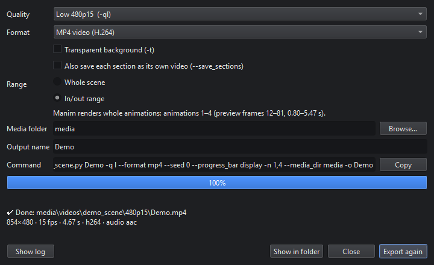

# Export and snapshots

- **Status:** Available
- **Renderer:** Cairo (whatever `manim render` uses; the Studio adds nothing to the render)
- **Since:** PR #15
- **Spec:** F01, F10 · **Backlog:** 1.5 · **Source:** `src/manim_stage/export.py`, `studio/ui/export_dialog.py`
- **Motion Canvas origin:** the editor's Render panel (image sequence / video) and "save snapshot". **Built on:** Manim's own CLI, `manim render` (`-q`, `--format`, `-t`, `--save_sections`, `-n`, `--media_dir`, `-o`, `--seed`), and PyAV for inspecting the result.



## What it is

Exports run Manim's own command line, so the Studio never encodes video itself. The dialog builds a `manim render …` command from your choices and shows it, so you can copy it and reproduce the export headlessly. It then runs Manim with a progress bar and a Cancel button, and finally reports what was written: size, frame rate, duration, codecs and audio.

**Save frame** renders the frame at the playhead at full quality. **Copy frame** copies the preview frame to the clipboard.

## Quick start

In the editor:
- **Export…** (Ctrl+E): pick a quality, a format and whole scene or in/out range, then **Export**.
- **Save frame…** (Ctrl+Shift+S): a full-quality PNG of the frame at the playhead.
- **Copy frame** (Ctrl+Shift+C): the preview frame to the clipboard.

From Python:

```python
from pathlib import Path

from manim_stage.export import ExportJob, ExportSettings, display_command, manim_command, snapshot

Path("clip.py").write_text('''
from manim import *

class Clip(Scene):
    def construct(self):
        self.play(Create(Circle()), run_time=0.5)
        self.play(FadeOut(Circle()), run_time=0.3)
''')

settings = ExportSettings(quality="low_quality", format="mp4", play_range=(1, 1))
print(display_command(manim_command("clip.py", "Clip", settings)))
# manim render clip.py Clip -q l --format mp4 --seed 0 --progress_bar display -n 1,1

result = ExportJob("clip.py", "Clip", settings).start().wait(300)
assert result.ok, result.error
print(result.probe["width"], result.probe["fps"], result.probe["duration_s"])  # 854 15.0 0.333…

png, frame = snapshot("clip.py", "Clip", 0.25, "frame.png", quality="low_quality")
print(png.name, frame)  # frame.png 3
```

## How it works

- **The command.** It is exactly `manim render FILE SCENE -q … --format … --seed …` plus your options, run from the scene's folder. It is shown relative to that folder, so you can paste it into a terminal there. The preview's seed (0) is always passed, so scenes that use `random` look the same as in the preview.
- **Range.** Manim renders whole animations: `-n FIRST,LAST` counts every `play` and `wait` call from 0. Your in/out range is widened to the calls it overlaps, and the dialog shows the result, e.g. "animations 1–4 (preview frames 12–81, 0.80–5.47 s)".
- **Formats.** Manim's own: MP4 (H.264), WebM (VP9), MOV, GIF, PNG sequence, or PNG of the last frame. Transparency (`-t`) is offered only for formats Manim can write with alpha: MOV, WebM, PNG.
- **Sections.** `--save_sections` also writes one video per `next_section`.
- **Where files go.** Manim's layout under the media folder (default `media/` next to the scene): `media/videos/<file>/<quality>/<name>.mp4`.
- **Progress** comes from Manim's progress bar (animation n of N). **Cancel** stops Manim and anything it started (LaTeX, FFmpeg).
- **Result check** (spec F10), read back with PyAV:
  - width × height, nominal fps and average fps (a mismatch is flagged as variable frame rate);
  - duration, video codec and pixel format;
  - audio streams (`add_sound` audio is mixed in by Manim).
- **Save frame** runs the scene in a [runner](runner.md) child at the chosen quality and draws just that frame. At the same quality it is pixel-identical to the preview frame.

## Options

| `ExportSettings` | Manim flag | Default |
|---|---|---|
| `quality` | `-q l/m/h/p/k` | `high_quality` |
| `format` | `--format` | `mp4` |
| `transparent` | `-t` | off |
| `save_sections` | `--save_sections` | off |
| `play_range` | `-n FIRST,LAST` | whole scene |
| `media_dir` | `--media_dir` | `media` next to the scene |
| `output_name` | `-o` | scene name |
| `seed` | `--seed` | 0 (same as preview) |

## Limitations and unsupported cases

- **Ranges snap to whole calls.** Cutting inside an animation would need re-encoding, which the Studio deliberately doesn't do.
- **Copy frame uses the preview resolution.** Use **Save frame** for full quality.
- **Video codecs are lossy.** An exported frame matches the preview within codec tolerance; PNG output is exact.
- OpenGL renders are not offered from the Studio yet.

## Related

- [Studio editor](studio-editor.md), [Timeline](timeline.md) (I/O range), [Scene runner](runner.md).
- Manim docs at the pinned commit: [Sound and sections](../manim/sound-and-sections.md).
