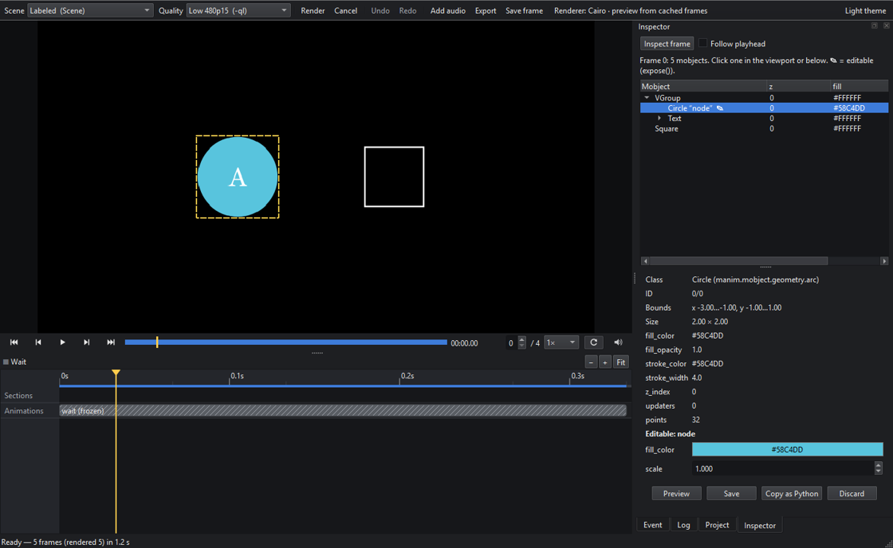

# Inspector and exposed properties

- **Status:** Available
- **Renderer:** Cairo
- **Since:** PR #28
- **Spec:** F08 · **Backlog:** 3.3, MF.5 · **Source:** `src/manim_stage/inspector.py`, `scene.py` (`StageMixin.expose`), `studio/ui/inspector_panel.py`
- **Motion Canvas origin:** the editor's node inspector (read-only properties of a selected node). **Built on:** Manim's Mobject families (`scene.mobjects`, `submobjects`) and public getters/setters (`get_fill_color`, `set_fill`, `move_to`, `scale`, `set_z_index`, …).



## What it is

Point at anything in the preview and see what it is: its Manim class, its `name`, its place in the Mobject family tree, bounds, colours, opacity, z-index and updaters. That works for **every** Mobject, read-only.

Objects you **opt in** with `self.expose(...)` get editors for the properties you declare. You preview an edit, save it to a sidecar, or copy it as Python. Your source is never changed behind your back.

## Quick start

```python
from manim import *
from manim_stage import StageScene

class Graph(StageScene):
    def construct(self):
        a = self.expose(Circle(color=BLUE, fill_opacity=1).shift(LEFT * 2), "node_a",
                        "fill_color", "scale", "position")
        b = Square().shift(RIGHT * 2)          # not exposed: inspectable, read-only
        self.add(a, b, Line(a.get_right(), b.get_left()))
        self.wait(0.2)

with tempconfig({"frame_rate": 10, "dry_run": True, "disable_caching": True}):
    Graph().render()
```

In the Studio:
1. Open the **Inspector** tab, then **Inspect frame** (Ctrl+I). Tick **Follow playhead** to re-inspect after each seek.
2. Click an object in the viewport. The deepest, topmost Mobject under the cursor is selected and outlined; it's also selected in the tree.
3. For an exposed object (marked ✎), change a property:
   - **Preview** re-renders with the change; nothing is saved.
   - **Save** writes `.manim-stage/properties.json` (undoable) and re-renders.
   - **Discard** drops the preview.
   - **Copy as Python** copies the same change as Manim calls, e.g. `node_a.set_fill(color="#FF0000")`.

## How it works

**`self.expose(mobject, name, *props)`:**
- sets the Mobject's `name`;
- records which properties may be edited;
- applies any saved values for `name` from `properties.json` right there, so plain `manim render` reproduces edits made in the Studio (the F08 acceptance test does exactly this).

Editable properties: `fill_color`, `stroke_color`, `color`, `fill_opacity`, `stroke_width`, `opacity`, `position`, `scale` (relative, applied once), `z_index`.

**Inspection:**
- The runner replays the scene to the playhead's frame (`--inspect-at SECONDS`, the same replay as preview frames) and walks `scene.mobjects`.
- Each node has a path ID (`0/2/1`) and what Manim's public API reports. Nothing is guessed for custom Mobject subclasses: they show their class and generic properties.
- Manim's empty placeholder Mobjects (e.g. from `wait()`) are skipped.

**Preview** writes your unsaved edits, merged with saved ones, to a temporary overrides file (`MANIM_STAGE_PROPERTIES`) and renders with it. That file is part of the cache key, so previews never reuse stale frames.

Schema: `docs/schemas/properties.schema.json`; the inspect message is in `runner-message.schema.json` (`MobjectNode`).

## Keyboard

| Key | Action |
|---|---|
| Ctrl+I | Inspect the frame at the playhead |

## Limitations and unsupported cases

- **Inspection is a snapshot of one frame.** It takes a replay, about as long as the timeline pass, not live.
- **Picking uses bounding boxes.** For overlapping shapes the topmost (z-index), deepest one wins; choose others in the tree.
- **Only declared properties of exposed objects are editable.** Dynamic properties driven by updaters or [signals](signals.md) may override edits each frame. The inspector shows the updater count so you can tell.
- **Cairo renderer only;** OpenGL scenes aren't previewed.

## Related

- [Timeline](timeline.md), [Signals](signals.md), [Project theme](project.md), [Data formats](../reference/data-formats.md).
