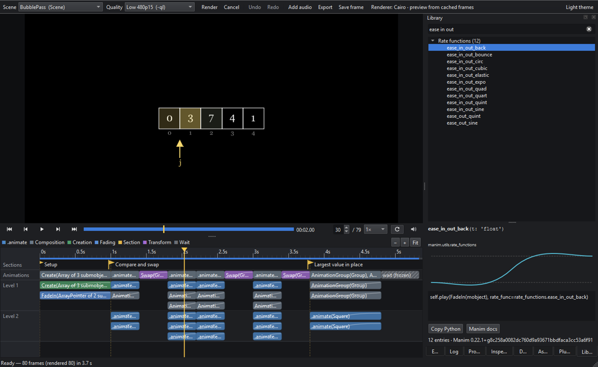

# Library and catalog of Manim features

- **Status:** Available
- **Since:** PR #35
- **Backlog:** MF.1 (catalog), MF.4 (Library panel) · **ADRs:** ADR-0011 · **Source:** `src/manim_stage/catalog.py` (`build_catalog`, `search`), `studio/ui/library_panel.py`; `manim-stage catalog`
- **Built on:** introspection of the installed Manim, so new upstream features appear without changes here.



## What it is

A searchable list of everything `from manim import *` gives you, plus manim-stage's own APIs. It's grouped the way Manim's packages are, and each entry has its signature, a docs summary, a link to the Manim reference page and a **Copy Python** snippet.

| Group | Examples | Extras |
|---|---|---|
| Mobjects (by sub-package: geometry, text, graphing, three_d…) | `Circle`, `MathTex`, `Axes` | Flags **needs LaTeX** and **3D** |
| Animations (by category: creation, fading, transform…) | `FadeIn`, `Transform` | Same colours as the [timeline](timeline.md) |
| Scene types, cameras | `MovingCameraScene`, `ThreeDCamera` | Class skeleton snippet |
| Rate functions | `smooth`, `rate_functions.ease_in_out_sine` | Curve drawn live |
| Colours | `BLUE`, `TEAL_C` | Swatch and hex |
| manim-stage | `Signal`, `AnimatedCode`, `Array`, `demo.param` | The right import line |
| Utilities, constants, modules | `interpolate`, `UP`, `config` | — |

## Quick start

- **Studio:** open the **Library** tab and type, for example `fade`, `circle` or `ease`. Double-click an entry, or press **Copy Python**, to put the snippet on the clipboard. **Manim docs** opens the reference page.
- **Command line:**

```bash
manim-stage catalog fade                       # search names and summaries
manim-stage catalog --kind rate_functions      # one group
manim-stage catalog --json > catalog.json      # everything, for tools
```

- **Python:**

```python
from manim_stage.catalog import catalog, search

print(search("fade")[0]["snippet"])            # self.play(FadeIn(mobject))
print(len(catalog()["kinds"]["mobjects"]))
```

## How it works

- Every public name in `manim` is classified once. A test checks that nothing is missed or listed twice: Manim has no `__all__`, so the test covers every name `from manim import *` imports.
- Groups come from Manim's module layout (`manim.mobject.geometry` → *geometry*). Animation groups reuse the timeline categories.
- Rate functions that `from manim import *` doesn't export (the `ease_*` family) are listed with a `rate_functions.` prefix.
- Building the catalog takes under a second. The Studio builds it the first time the tab opens.

## Limitations and unsupported cases

- **Snippets fill only required arguments,** using their parameter names (`Transform(mobject)`); add the rest yourself.
- **Copy only.** The Studio doesn't edit your scene file.
- **Manim plugins' own classes** appear only if they are re-exported by `manim`; installed plugins are listed under **Plugins**.

## Related

- [Timeline](timeline.md) (same categories and colours), [Studio plugins](plugins.md), [CLI](cli.md).
