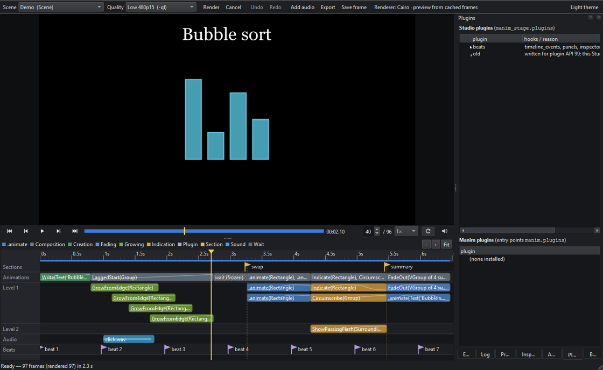

# Studio plugins (SDK, API version 1)

- **Status:** Available
- **Since:** PR #32
- **Spec:** F11 · **Backlog:** 4.1 · **ADRs:** ADR-0009 · **Source:** `src/manim_stage/plugins.py`, `studio/ui/plugins_panel.py`; sample: `examples/plugins/stage_beats/`
- **Motion Canvas origin:** editor plugins (tabs, timeline additions, exporters). **Built on:** Python entry points, the same mechanism Manim uses for `manim.plugins`.



## What it is

Extend the Studio without changing it. A plugin is a Python object, registered as an entry point, that can:
- add events on its own **timeline lane**;
- add **dock panels**;
- add rows to the **inspector**;
- add **commands** with shortcuts;
- add **post-export actions**.

Plugins declare the API version they were written for. The Studio disables any that don't match, says why, and keeps running.

## Quick start

`my_plugin.py`:

```python no-run
class Chapters:
    name = "chapters"
    api_version = 1                     # must equal manim_stage.plugins.API_VERSION

    def timeline_events(self, timeline, api):
        # one marker per Manim section, on the "Chapters" lane
        return [{"label": e["label"], "start_frame": e["start_frame"]}
                for e in timeline["events"] if e["kind"] == "section"]

    def panels(self, api):
        from PySide6.QtWidgets import QLabel
        return [("Chapters", lambda: QLabel("Sections become chapters"))]

    def commands(self, api):
        return [("Go to middle", "Ctrl+M", lambda: api.seek(api.total_frames() // 2))]

plugin = Chapters()
```

Register it in the plugin's `pyproject.toml`:

```toml
[project.entry-points."manim_stage.plugins"]
chapters = "my_plugin:plugin"
```

…or, while developing, `MANIM_STAGE_PLUGINS="my_plugin:plugin"` (comma-separated). Then `manim-stage plugins` lists it, and the Studio's **Plugins** tab shows ✔ or ⚠ with the reason.

## Hooks

All hooks are optional.

| Hook | Returns | Used for |
|---|---|---|
| `timeline_events(timeline, api)` | list of `{"label", "start_frame", "end_frame"?, "meta"?}` | Events on the lane `plugin:<name>`; IDs `<scene>:plugin:<name>:<n>#0`. `timeline` is the [timeline JSON](../reference/data-formats.md). |
| `panels(api)` | list of `(title, factory)`; `factory()` returns a `QWidget` | Dock tabs |
| `inspector_rows(node, api)` | list of `(label, value)` | Extra rows when a Mobject is selected in the [inspector](inspector.md) |
| `commands(api)` | list of `(label, shortcut or "", callback)` | Editor actions |
| `exporters(api)` | list of `(label, fn(result) -> message)` | Buttons in the [Export](export.md) dialog after a render (`result.output`, `result.probe`) |

**`api` (`StudioAPI`)** is everything a plugin may touch:
- read: `scene()`, `timeline()`, `frame()`, `total_frames()`, `fps()`;
- act: `seek(frame)`, `status(text)`, `log(text)`.

Plugins are local Python, trusted like your scenes. The Studio gives them no extra file-system or network access, and it never runs anything from a remote source.

## Compatibility handshake

- `api_version` must equal `manim_stage.plugins.API_VERSION` (1). Otherwise the plugin is listed as disabled ("written for plugin API 2; this Studio provides 1") and never called.
- A plugin that fails to import, implements no hooks, or raises inside a hook is disabled with the reason and traceback in the Plugins tab and the log. The editor keeps working.
- Manim's own plugins (`manim.plugins` entry points) are listed read-only beside them. They're loaded by Manim itself when scenes run.

## The sample plugin

`examples/plugins/stage_beats/` adds:
- a **Beats** lane (a marker per beat at 60 BPM);
- a **Beats** panel;
- inspector rows;
- a **Next beat** command (Ctrl+B);
- a post-export **Beat count**.

It also has a deliberately incompatible `old_plugin` (API 99) to show the handshake. `tests/test_plugins.py` loads it into the real editor; this is the spec's F11 acceptance test.

```bash
pip install -e examples/plugins/stage_beats
manim-stage plugins
```

## Limitations and unsupported cases

- **Editor-side only.** Plugins can't change how scenes render. For that, write a Manim plugin or library and import it in your scenes.
- **No sandboxing.** A plugin that blocks or crashes the process can't be contained; failures are only caught at the hook boundary.

## Related

- [Timeline](timeline.md), [Inspector](inspector.md), [Export](export.md), [CLI](cli.md).
