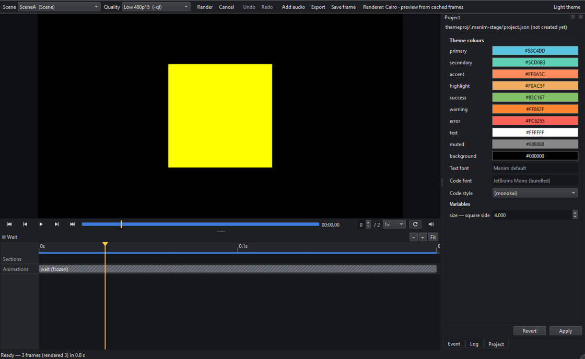

# Project theme and variables

- **Status:** Available
- **Renderer:** Both
- **Since:** PR #27
- **Spec:** F07 · **Backlog:** 3.2 · **ADRs:** ADR-0013 · **Source:** `src/manim_stage/project.py`, `studio/ui/project_panel.py`
- **Motion Canvas origin:** project variables (`useScene().variables`) and the project settings. **Built on:** Manim's `config` for render settings, `camera.background_color`, and `Text.set_default` for the text font.



## What it is

A lesson usually has many scenes that should look alike: one accent colour, one font, one code style. `.manim-stage/project.json` holds a **theme** and typed **variables** that every scene in the project reads. Change the accent once, in the Studio's **Project** panel or in the file, and every participating scene re-renders. No scene source changes.

## Quick start

```python
from pathlib import Path

from manim import *
from manim_stage import StageScene, project

class Title(StageScene):
    def construct(self):
        theme = project.theme()
        speed = project.var("speed", 1.0, min=0.25, max=4, description="animation speed")
        dot = Dot(color=theme.accent)
        self.play(Create(Circle(color=theme.primary)), run_time=1 / speed)
        self.add(dot)

# the project file (the Studio's Project panel writes the same thing)
p = project.load(Path(".manim-stage/project.json"))
p.theme.colors["accent"] = "#FF8A5C"
p.variables["speed"] = project.Variable("speed", "number", value=2.0)
project.save(p)

with tempconfig({"frame_rate": 10, "dry_run": True, "disable_caching": True}):
    Title().render()
print(project.USED["speed"].value)   # 2.0
```

## How it works

**Theme** (`project.theme()`), attribute or name access, e.g. `theme.accent` or `theme.color("accent")`:
- **Colours:** semantic names `primary`, `secondary`, `accent`, `highlight`, `success`, `warning`, `error`, `text`, `muted` and `background`. The defaults are Manim's own colour constants; add your own names.
- **`font`:** default font for `Text` and `MarkupText`.
- **`code_font` / `code_style`:** defaults for [AnimatedCode](animated-code.md) (any Pygments style).
- **`StageScene` applies it:** the scene uses the theme's `background` and `font` when it starts and restores Manim's defaults when it ends.

**Variables** (`project.var(name, default, *, min, max, options, type, description)`):
- **Value:** the value from `project.json` if set, else your `default`. Reading a variable is the explicit opt-in that makes it editable in the Studio (spec F07).
- **Types:** inferred from the default (number, integer, boolean, text, colour `"#RRGGBB"`), or `options=[...]` for a choice. Stored values are validated; a bad value fails the render, naming the variable.
- **Studio:** the runner reports which variables the scene read, with their defaults and limits. The Project panel shows a typed editor for each (spin box, checkbox, colour button, choice list).

**Where it applies:**
- **One file per project:** `.manim-stage/project.json`, found in the nearest folder at or above the scene that has `.manim-stage/`. `MANIM_STAGE_PROJECT` overrides it.
- **Everywhere:** plain `manim render`, the Studio preview and CI all read the same file.
- **Re-rendering:** the file is a tracked dependency, so editing it re-renders and invalidates cached frames.
- **Safe writes:** writes are validated, atomic (with a `.bak` copy) and undoable in the Studio (Ctrl+Z).

Schema: `docs/schemas/project.schema.json` (see [data formats](../reference/data-formats.md)).

## Limitations and unsupported cases

- **Render size and frame rate** stay Manim's (`-q`, `manim.cfg`, the Studio's quality preset). `settings` in `project.json` is reserved for later.
- **Font defaults** apply to `Text`/`MarkupText`; `Tex`/`MathTex` use LaTeX templates (MF.10).
- **Variables are read when the scene runs.** A value changed in the editor re-renders; it doesn't change a running preview.

## Related

- [Signals](signals.md), [AnimatedCode](animated-code.md), [Studio editor](studio-editor.md), [Motion Canvas equivalents](../reference/motion-canvas-equivalents.md).
