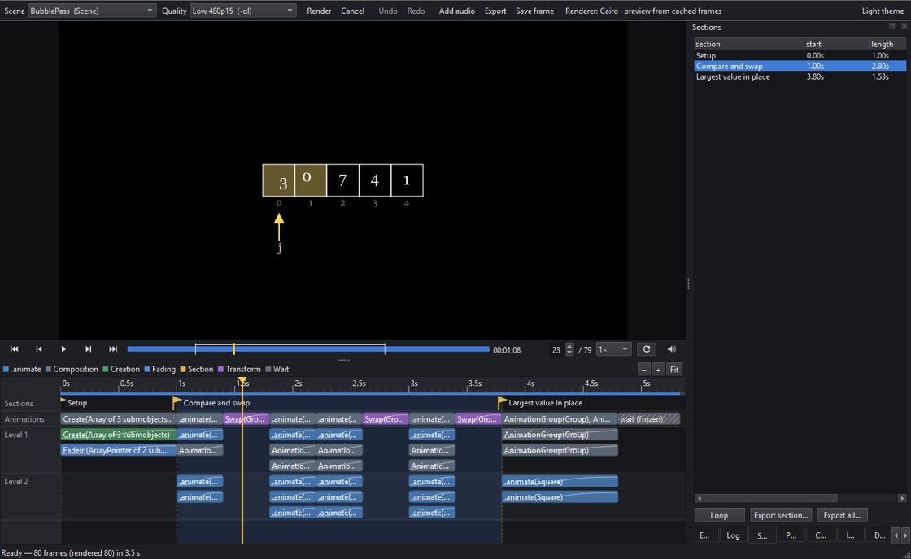

# Sections navigator

- **Status:** Available
- **Since:** PR #36
- **Backlog:** MF.7 · **Spec:** F02, F10 · **Source:** `studio/ui/sections_panel.py`
- **Built on:** Manim's `Scene.next_section(name, section_type, skip_animations)` and `--save_sections`.



## What it is

The **Sections** tab lists the scene's Manim sections with start time, length and type. A section marked `skip_animations=True` shows as *(skipped)*, because Manim leaves it out of the video. From the tab you can:
- **click** a section to jump to its start;
- **Loop** it, which sets the in/out range to it;
- **Export section…**, which opens Export with that range;
- **Export all…**, which exports the whole scene with Manim's `--save_sections`, giving one video per section.

## Quick start

```python no-run
class Lesson(Scene):
    def construct(self):
        self.next_section("Setup")
        self.play(Create(arr))
        self.next_section("Compare and swap")
        ...
        self.next_section("Outtakes", skip_animations=True)   # listed as (skipped)
```

Run `manim-stage studio lesson.py Lesson` and open the **Sections** tab.

## How it works

- **A section runs** from its `next_section` call to the next one, or to the end of the scene. Content before the first named section is listed as *(start)*.
- **Section exports use the in/out range,** so they snap to whole `play`/`wait` calls, like any [range export](export.md).
- **The same sections** become chapters in the [web player](web-player.md) and markers on the [timeline](timeline.md)'s Sections lane.

## Limitations and unsupported cases

- **Section types are shown, not edited.** Change them in the scene code.

## Related

- [Timeline](timeline.md), [Export](export.md), [Web player](web-player.md), [Config](config.md).
