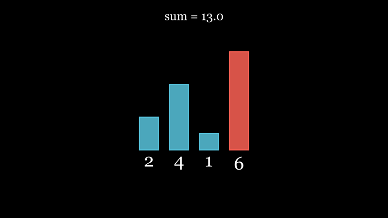

# Signals, computed values and bindings

- **Status:** Available
- **Renderer:** Both (values only)
- **Since:** PR #26
- **Spec:** F06 · **Backlog:** 3.1 · **ADRs:** ADR-0013 · **Source:** `src/manim_stage/signals.py`, `scene.py` (`StageMixin.effect`, `.bind`)
- **Motion Canvas origin:** `createSignal`, `createComputed`, `createEffect`, and node properties bound to signals. **Built on:** Manim's `ValueTracker` (a `Signal` *is* one) and updaters.



## What it is

Teaching animations often show one piece of state many ways. An array appears as bars, as number labels, as a pointer to its largest element, and as a running total. In plain Manim you write an updater for each. With signals you describe each view **as a function of the state**, then animate the state once.

## Quick start

```python
import numpy as np
from manim import *
from manim_stage import StageScene, Signal, computed

class ArrayView(StageScene):
    def construct(self):
        values = Signal([5, 2, 4, 1])                        # a ValueTracker holding a list
        biggest = computed(lambda: int(np.argmax(values())))  # derived, cached

        bars = VGroup(*[Rectangle(width=0.6, height=1, fill_opacity=0.8) for _ in range(4)])
        bars.arrange(buff=0.3, aligned_edge=DOWN)
        for i, bar in enumerate(bars):
            self.bind(bar, height=lambda i=i: values()[i] * 0.5, align=DOWN,
                      color=lambda i=i: RED if biggest() == i else BLUE)
        self.add(bars)

        self.play(values.animate.set_value([2, 5, 4, 1]))   # bars and colours follow
        self.play(values.animate.set_value([1, 2, 4, 5]))

with tempconfig({"frame_rate": 10, "dry_run": True, "disable_caching": True}):
    ArrayView().render()
```

## How it works

**`Signal(value)`** is a `ValueTracker`:
- It can hold a **number**, a **list of numbers**, a **NumPy array** (e.g. a point) or a **colour**. Each component is stored in the tracker's points, so `self.play(s.animate.set_value(new))` interpolates every component; colours interpolate in RGBA.
- Read it with `s()`, `s.value` or `s.get_value()`; write it with `s.set_value(v)`. Updaters, `always_redraw` and `.animate` work as for any `ValueTracker`.

**`computed(fn)`** (also usable as `@computed`):
- **Lazy:** it evaluates only when read.
- **Tracked:** reading signals or other computed values inside `fn` makes them dependencies, discovered automatically.
- **Cached:** it re-evaluates only if a dependency's value actually changed. Frames where nothing changed cost nothing.
- **Cycle-checked:** a computed value that depends on itself raises `CycleError` with the chain (`x -> y -> x`).

**`self.bind(mobject, **props)`**, or `bind(mobject, ..., scene=self)` in any `Scene`:
- It is a Manim updater that sets properties from expressions and **only when their inputs changed**.
- Properties: `x`, `y`, `position`, `height`, `width` (with `align=DOWN` etc. to keep that edge fixed, like a bar on a baseline), `color`, `fill_color`, `stroke_color`, `opacity`, `fill_opacity`, `stroke_width`, and `value` (for `DecimalNumber`, `Integer`, `ValueTracker`).
- `update=lambda m: ...` runs any code when its inputs change, and after any bound property changed (e.g. re-place a label whose number got wider).

**`self.effect(fn)`** runs `fn` now and again whenever something it read changes. It is a scene updater.

**Lifecycle:** effects and bindings made through a `StageScene` are disposed when the scene ends (`tear_down`); no updaters are left behind. Outside a `StageScene`, call `.dispose()`.

**Determinism:** evaluation is pull-based. Bindings run in creation order and each pulls its inputs, so every frame is computed the same way, which is what preview/export parity needs.

## Diagnostics

| Problem | What you get |
|---|---|
| A computed value depending on itself | `CycleError: computed values depend on themselves: total -> avg -> total` |
| An impure computed (reads the clock, `random`, files) | `c.check_purity()` returns `False`. Such values make replays differ; the [runner's determinism warnings](runner.md#determinism-warnings) flag clock and entropy reads too. |
| An unknown property in `bind` | `ValueError` listing the supported ones |
| A list signal set to a different length | `ValueError` |

`untracked(lambda: s())` reads without creating a dependency (Motion Canvas `peek`).

## Limitations and unsupported cases

- **Non-numeric values.** Signals hold numbers, number lists and arrays, and colours. Strings and objects can't be interpolated; use a `computed` that maps a number to them.
- **Text.** `bind(..., update=...)` with `m.become(Text(...))` re-creates text when inputs change. That is fine for labels, but heavy for long text each frame.

## Related

- [Motion Canvas equivalents](../reference/motion-canvas-equivalents.md), [AnimatedCode](animated-code.md), [Named cues](cues.md).
