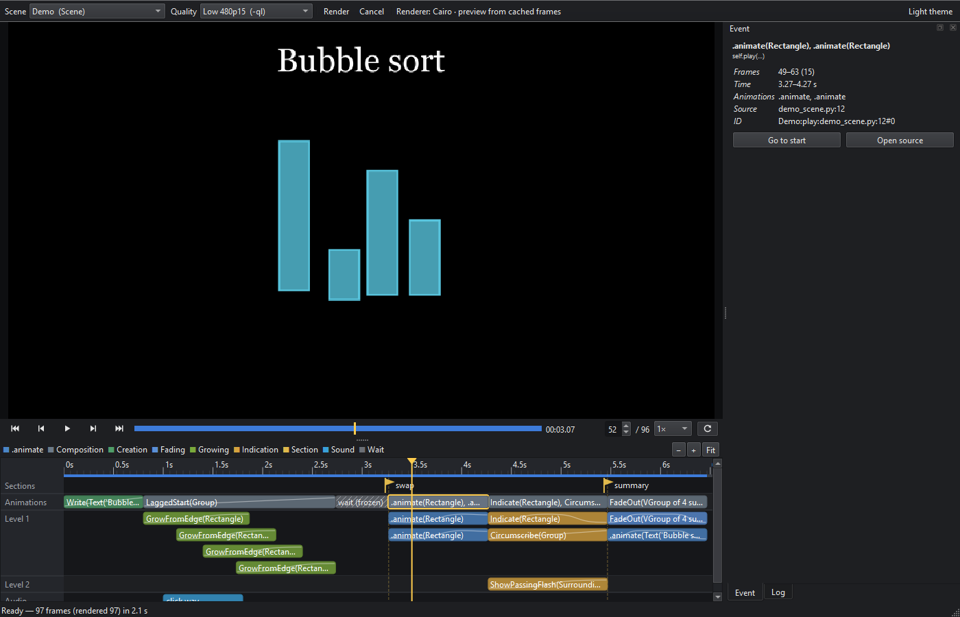

# Studio editor

- **Status:** Partial. Scene picker, viewport, playback, [timeline](timeline.md), live reload and errors are available. [Export and snapshots](export.md) are available. Start it with [`manim-stage studio`](cli.md).
- **Renderer:** Cairo (OpenGL scenes are labelled unsupported)
- **Since:** PR #12 (timeline: PR #14)
- **Spec:** F01 · **ADRs:** ADR-0010, ADR-0012, ADR-0013 · **Source:** `src/manim_stage/studio/ui/`, `studio/app.py`, `studio/playback.py`
- **Motion Canvas origin:** the editor's viewport, playback controls and settings. **Built on:** Manim scenes rendered in child processes by the [preview service](preview-service.md); Manim's quality presets (`manim.constants.QUALITIES`).



## What it is

A desktop editor, written in Python with PySide6, for previewing Manim scenes while you write them. Open a scene file, pick a `Scene` class, and scrub, play and step through the frames Manim rendered. Save the file in your code editor and the preview re-renders.

## Quick start

Install the `studio` extra, then open a scene file:

```bash
pip install "manim-stage[studio]"
manim-stage studio lesson.py                      # first Scene in the file
manim-stage studio lesson.py Intro -q medium_quality
```

`python -m manim_stage.studio …` does the same.

From Python, for example to embed or automate it:

```python no-run
from PySide6.QtWidgets import QApplication
from manim_stage.studio.app import create_window

app = QApplication([])
window, service = create_window("lesson.py", "Intro", quality="low_quality", workers=2)
window.show()
app.exec()
```

## How it works

- **Scenes.** The scene picker lists the `Scene` subclasses defined in the file, with their Manim base class (for example `MovingCameraScene`). It refreshes when the file changes, and keeps the selected scene if it still exists.
- **Quality.** Manim's own presets: Low 480p15 (`-ql`), Medium 720p30 (`-qm`), High 1080p60 (`-qh`), Production 1440p60 (`-qp`), 4K 2160p60 (`-qk`). Changing it re-renders.
- **Viewport.** It shows the frame Manim rendered for the playhead; it never draws scene content itself. If that frame isn't rendered yet, it shows the nearest earlier frame and a "Rendering… n/N frames" overlay.
- **Playback.** Time is measured in integer frames. Play follows wall time × speed, so it doesn't drift. If the next frame isn't rendered yet, playback holds (⏳ after the timecode) and then resumes. Loop and an in/out range are supported.
- **Scrub bar.** Filled segments are rendered frames; the rest is still rendering. Click or drag to seek.
- **Live reload.** Saving the scene file or any file it uses (helper modules, images, data) starts a new render; the old one is cancelled. The playhead stays where it was if that frame still exists. Otherwise it resets to the start and the status bar says so.
- **Errors.** The message and file:line show on the viewport and in the log, with the traceback. **Open file:line** jumps to it in your code editor: set `MANIM_STAGE_EDITOR`, e.g. `code -g {file}:{line}` or `subl {file}:{line}`. Without it, VS Code (`code`) is used if found, else the system default app.
- **Timeline and Event panel.** Under the viewport; see [Timeline](timeline.md). The Event and Log panels share the right dock as tabs; an error brings the Log forward.
- **Renderer badge.** It says what the preview is: Cairo, from cached frames. OpenGL is not supported in the preview yet, and is never silently substituted (spec §2.7).

## Keyboard shortcuts

| Key | Action |
|---|---|
| Space | Play / pause |
| ← / → | Previous / next frame |
| Shift+← / Shift+→ | Back / forward 1 second |
| Home / End | Start / end (of the range, if set) |
| I / O | Set range start / end at the playhead |
| Alt+X | Clear range |
| L | Toggle loop |
| Ctrl+R | Re-render |
| Ctrl+Z / Ctrl+Shift+Z (Ctrl+Y) | Undo / redo cue edits |
| Ctrl+Shift+A | Add audio… (at the playhead) |
| Ctrl+E | Export… |
| Ctrl+Shift+S | Save frame (full quality) |
| Ctrl+Shift+C | Copy frame (preview) |
| Esc | Cancel rendering |
| Ctrl+0 / Ctrl+1 | Zoom to fit / 100% |
| Ctrl++ / Ctrl+- (or Ctrl+wheel) | Zoom in / out |
| Ctrl+Shift+T | Dark / light theme |

Timeline-specific keys: see [Timeline → keyboard](timeline.md#keyboard-timeline-focused).

## Accessibility

- Every control has an accessible name and a tooltip naming its shortcut. The whole editor is keyboard-operable.
- State is shown in words (status bar, overlays, ⏳, ⚠), never by colour alone.
- Qt follows the system's text scaling. Theme colours meet WCAG AA contrast.

## Options

| `manim-stage studio` | Default | Meaning |
|---|---|---|
| `file` | required | Python file with Manim `Scene` classes |
| `scene` | first in file | Scene class to open |
| `-q`, `--quality` | `low_quality` | Manim quality preset for the preview |
| `--workers` | half the CPUs, at most 4 | Parallel drawing processes |
| `--cache-dir` | per-user cache folder | Frame cache. Windows: `%LOCALAPPDATA%/manim-stage/frames`; macOS: `~/Library/Caches/manim-stage/frames`; Linux: `~/.cache/manim-stage/frames` |
| `--no-watch` | off | Don't re-render on save |

Preferences (theme) are stored in an INI file under the user's config folder (`manim-stage/studio.ini`).

## Limitations and unsupported cases

- **Qt version:** on Python 3.11 the `studio` extra installs PySide6 < 6.12. PySide6 6.12.0 corrupts reference counts on every signal under Python 3.11 on Linux and crashes the editor; Python 3.12+ is unaffected. `tests/test_qt_sanity.py` guards this.

- OpenGL-renderer scenes are not previewed.
- Audio does not play during preview yet (M2 audio workspace).
- Opening a file executes its Python. Open trusted projects only.

## Related

- [Preview service](preview-service.md) (the engine), [Frame cache](frame-cache.md), [Scene runner](runner.md).
- [Motion Canvas equivalents](../reference/motion-canvas-equivalents.md).
