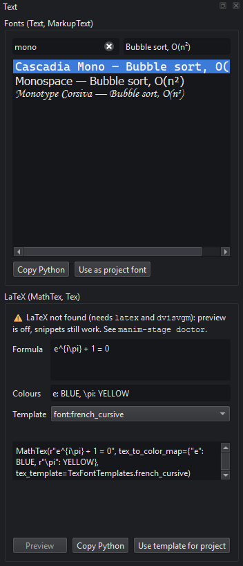

# Text and LaTeX helpers

- **Status:** Available. LaTeX preview needs a LaTeX install.
- **Since:** PR #38
- **Backlog:** MF.10 · **Spec:** F07 · **Source:** `src/manim_stage/typography.py`, `studio/ui/text_panel.py`; theme key `tex_template`
- **Built on:**
  - Manim's `Text(font=)`, Pango's font list (`manimpango.list_fonts()`);
  - `MathTex(tex_to_color_map=, tex_template=)`, `TexTemplateLibrary`, `TexFontTemplates`, `Mobject.set_default`.



## What it is

The Studio's **Text** tab has two halves.

| Section | Does |
|---|---|
| **Fonts** | Lists every font Manim's `Text` can use, each drawn in its own face with your sample text. **Copy Python** gives `Text("…", font="…")`. **Use as project font** sets the [project theme](project.md) font (undoable), which `StageScene` applies to all `Text`/`MarkupText`. |
| **LaTeX** | Takes a formula, coloured parts (`e: BLUE, \pi: #FF0000`) and a template (`default`, `simple`, `ctex`, `threeb1b`, or any of the 52 `TexFontTemplates`). It shows the `MathTex(...)` call and warns about parts not found in the formula. **Preview** renders it with Manim. **Use template for project** sets `theme.tex_template`. |

## Quick start

In code, using the same helpers:

```python
from manim_stage.typography import fonts, mathtex_snippet, tex_templates

print(fonts()[:5])
print(list(tex_templates())[:6])
print(mathtex_snippet(r"e^{i\pi} + 1 = 0", {"e": "BLUE", r"\pi": "YELLOW"}, "font:french_cursive"))
# MathTex(r"e^{i\pi} + 1 = 0", tex_to_color_map={"e": BLUE, r"\pi": YELLOW},
#         tex_template=TexFontTemplates.french_cursive)
```

A project-wide TeX template, in `.manim-stage/project.json`:

```json
{"schema": "manim_stage.project", "version": 1, "theme": {"tex_template": "font:french_cursive"}}
```

`StageScene` makes it the default for every `MathTex` and `Tex` in the scene, using Manim's `set_default`, and restores Manim's default afterwards.

## How it works

- **Snippets are valid Python.** LaTeX goes in raw strings, so `\pi` stays `\pi`.
- **Colouring uses Manim's own `tex_to_color_map`,** so the snippet behaves exactly like hand-written Manim.
- **The preview** renders the formula in a child process (`python -m manim_stage.typography`) into a transparent PNG. LaTeX errors show in the tab.

## Limitations and unsupported cases

- **Preview needs LaTeX.** It requires `latex` and `dvisvgm`; without them the Preview button is off, and snippets and templates still work. `manim-stage doctor` checks for them. The preview path wasn't exercised on this project's development machine or in CI (neither has LaTeX installed); it's covered by a test that runs when LaTeX is present.
- **Substring colouring follows Manim's rules.** A part must appear as its own TeX group to be coloured on its own; see Manim's `substrings_to_isolate`.
- **Large font lists.** The font list is whatever Pango sees, so system font folders with thousands of fonts make it long; use the search box.

## Related

- [Project theme](project.md), [Library](library.md), [Assets](assets.md) (fonts used by scenes).
