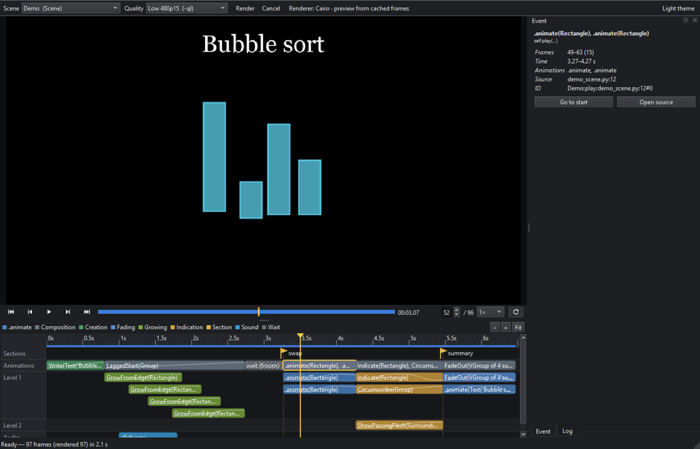

# Timeline

- **Status:** Available
- **Renderer:** Cairo
- **Since:** PR #14
- **Spec:** F02 · **Backlog:** 1.4, MF.3 · **ADRs:** ADR-0005, ADR-0011, ADR-0013 · **Source:** `src/manim_stage/studio/ui/timeline.py`, `studio/timeline_model.py`, `studio/ui/event_panel.py`
- **Motion Canvas origin:** the editor timeline (scenes, time events, audio). **Built on:** [event capture](event-capture.md) of Manim's `play`/`wait`/`next_section`/`add_sound` calls and [animation metadata](event-capture.md#animation-metadata).



## What it is

The Studio's timeline shows what your scene does, call by call, in Manim terms. It shows when each `self.play(...)`, `self.wait(...)`, `self.next_section(...)` and `self.add_sound(...)` happens. It also shows every member of an `AnimationGroup`, `LaggedStart` or `Succession`, each animation's class and rate function, and where each call is in your source. Use it to scrub, to find the line that produced a moment, and to check timing.

## Quick start

Open a scene in the [Studio editor](studio-editor.md); the timeline sits under the viewport.

- Click or drag on the ruler, or on empty lane space, to move the playhead.
- Click a bar to select it. The **Event** panel shows its details and rate curve.
- Double-click a bar (or **Open source** in the Event panel) to open its line in your code editor.
- Ctrl+wheel zooms around the cursor; Shift+wheel scrolls; **Fit** shows the whole scene.

The layout is also available without Qt:

```python
from manim import *
from manim_stage.capture import capture
from manim_stage.studio.timeline_model import build_layout

class Steps(Scene):
    def construct(self):
        dots = [Dot().shift(i * RIGHT) for i in range(3)]
        self.play(LaggedStart(*[FadeIn(d) for d in dots], lag_ratio=0.5), run_time=1)
        self.next_section("end")
        self.wait(0.5)

with tempconfig({"frame_rate": 10, "dry_run": True}):
    layout = build_layout(capture(Steps).to_dict())

for lane in layout.lanes:
    print(lane.title, [[(b.label, b.start, b.end) for b in row] for row in lane.rows])
assert [ln.key for ln in layout.lanes] == ["sections", "main", "level1"]
```

## How it works

**Lanes**, top to bottom:

| Lane | Shows |
|---|---|
| Sections | `next_section` flags with their names. A section with `skip_animations=True` is marked "(skipped)". A dashed line runs down through all lanes. |
| Animations | One bar per `play` or `wait` call |
| Level 1, 2, … | Members of animation groups, one lane per nesting depth. Members that overlap in time (as in `AnimationGroup`) get extra rows, so nothing is hidden. A `LaggedStart` reads as a staircase. |
| Audio | `add_sound` clips |
| Captions | Subcaptions, if any |

**Bars** use Manim's own vocabulary:
- The colour is the animation's category, taken from Manim's modules: creation, fading, transform, indication, movement, rotation, growing, numbers, changing, composition, speed modifier, updaters, specialized, `.animate`, custom. The legend above the timeline lists the categories present.
- Every bar is also labelled, so colour is never the only signal.
- The thin line inside a bar is its `rate_func` curve, sampled by the runner, so custom rate functions are drawn as they really are.
- Waits are hatched. "wait (frozen)" means Manim froze the frame because no updaters were running.

**Event panel** (right dock, tabbed with Log):
- the call (`self.play(…)`, …);
- frames and seconds;
- animation class, category, `run_time`, `rate_func` (with a larger curve), `lag_ratio`, the `.animate` method chain, the target Mobject and its name;
- whether the animation adds or removes its Mobject;
- section type and `skip_animations`, sound file and gain;
- source file:line and the event ID.

**Other details:**
- **Ruler:** labelled in seconds. It switches to per-frame ticks when zoomed in. The strip under it shows which frames are rendered.
- **Selection survives re-renders**, because event IDs are stable (`scene:kind:file:line#occurrence`, ADR-0005).
- **The in/out range** set with I/O in the editor is shaded across the timeline.

## Keyboard (timeline focused)

| Key | Action |
|---|---|
| Alt+← / Alt+→ | Select previous / next event (reading order) |
| Enter | Move the playhead to the selected event's start |
| Ctrl+Enter | Open the selected event's source line |
| + / − | Zoom in / out |
| F | Fit the whole scene |

The editor-wide shortcuts (Space, ←/→, Home/End, I/O, …) keep working; see [Studio editor → shortcuts](studio-editor.md#keyboard-shortcuts).

## Limitations and unsupported cases

- Editing timing by dragging comes with cues (M2, backlog 2.2); the timeline is read-only until then. Python stays the source of truth (spec F02).
- Audio clips have no waveform yet (M2 audio workspace).
- Spans of members of custom `Animation` subclasses with non-standard `interpolate` timing may be approximate (see [event capture](event-capture.md)).
- Updaters and `ValueTracker` changes are not separate tracks yet (MF.5).

## Related

- [Studio editor](studio-editor.md), [Event capture](event-capture.md), [Data formats](../reference/data-formats.md).
- [Motion Canvas equivalents](../reference/motion-canvas-equivalents.md).
