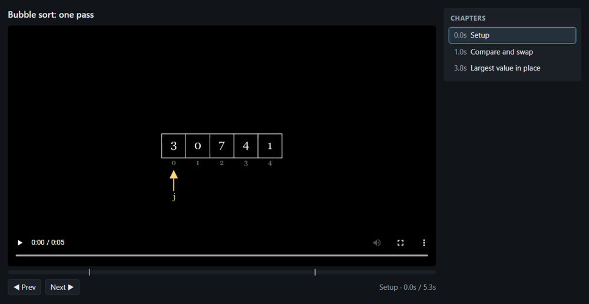

# Web player with chapters

- **Status:** Available
- **Since:** PR #34
- **Spec:** F12 · **Backlog:** 4.3 · **Source:** `src/manim_stage/web.py`; `manim-stage web`; Export dialog option
- **Motion Canvas origin:** presentation/playback of a finished animation in the browser. **Built on:** Manim's rendered MP4 and the captured [timeline](timeline.md): sections, cues and subcaptions.



## What it is

A small static site for a rendered scene. Open it from disk or host it anywhere; it doesn't need a server.

| File | Contents |
|---|---|
| `index.html` | Player, chapter list, Prev/Next buttons, captions. No external requests. |
| The video | Copied next to the page |
| `poster.jpg` | Still shown before playback |
| `chapters.vtt`, `captions.vtt` | Standard WebVTT for other players |
| `player.json` | Title, duration, chapters, captions |

Chapters come from Manim sections (`self.next_section("Swap")`). Without sections they come from named [cues](cues.md); otherwise there's one chapter. Captions come from `add_subcaption` and [narration](narration.md). The scene's Python never runs in the browser.

## Quick start

```bash
manim-stage web lesson.py Lesson                    # renders (high quality), then builds
manim-stage web lesson.py Lesson -q low_quality -o site/
manim-stage web lesson.py Lesson --video media/videos/lesson/1080p60/Lesson.mp4
```

In the Studio, tick **Also build a web player with chapters** in the [Export](export.md) dialog. The site is written to `<output name>_web/` beside the video. For a range export, chapters are re-based to the range.

```python no-run
self.next_section("Setup")
self.play(Create(arr))
self.next_section("Compare and swap")   # a chapter starts here
```

## Player

- Click a chapter to jump to it.
- **Prev** and **Next** (or `[` and `]`) move between chapters; Prev restarts the current chapter first, like most players.
- The progress bar shows a tick at each chapter start.
- Captions show automatically when the scene has subcaptions.
- Times show tenths of a second for clips under a minute, otherwise `m:ss`.

## Limitations and unsupported cases

- **Some browsers can't decode the video.** The player relies on the browser's own decoder; Manim's default MP4 (H.264) plays in all current browsers. A transparent MOV won't play in most browsers.
- **Composed sequences** (`manim-stage compose`) aren't covered yet. Use `--video` with one scene's timeline, or one section per scene.
- **Demo parameters can't be changed in the page.** See [Demo parameters](demo-params.md).

## Related

- [Export](export.md), [CLI](cli.md), [Timeline](timeline.md), [Narration](narration.md).
