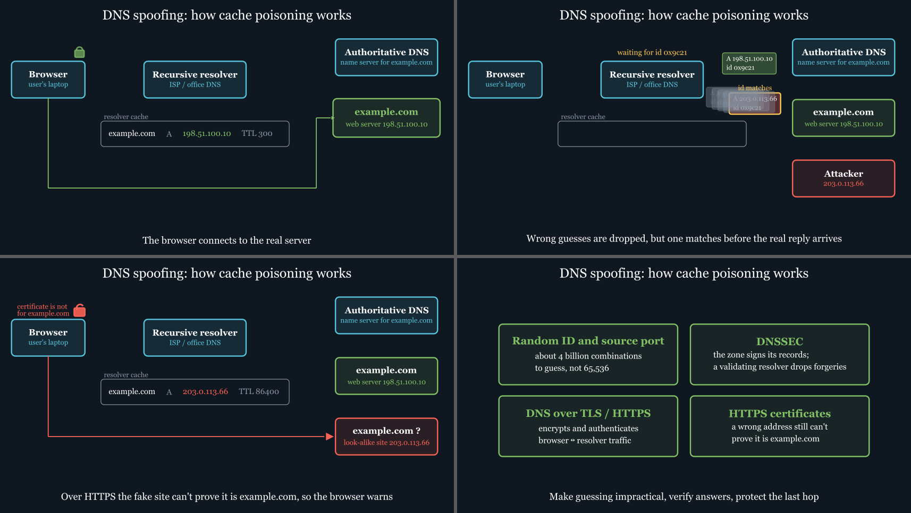

# Tutorial: DNS spoofing explained with graphics

- **Status:** Available (example)
- **Since:** the feature-lessons PR (2026-11-28)
- **Spec:** F03, F06, F07, F09, F12 · **Source:** [`examples/dns_spoofing/`](../../../examples/dns_spoofing/) · **Test:** `tests/test_dns_spoofing_example.py`



`examples/dns_spoofing/` is a 47-second explainer of **DNS cache poisoning**: how an attacker gets a resolver to cache a false address, and what stops it. It's a concept diagram built from Manim shapes, with no attack code. It uses the documentation addresses from RFC 5737 (`198.51.100.10` is the real site, `203.0.113.66` the attacker) and the reserved name `example.com`.

## The story, chapter by chapter

| Chapter (section) | Cues | What happens on screen |
|---|---|---|
| Normal lookup | `lookup_starts`, `answer_cached` | The browser asks the recursive resolver. The cache is empty, so the resolver asks the authoritative name server, with transaction ID `0x3a7f`. The reply has the same ID and is accepted. It's cached with `TTL 300`, and the browser connects to the real server (green padlock). |
| Cache poisoning | `ttl_expired`, `flood`, `poisoned` | The TTL counts down to 0 and the record goes. The attacker triggers a new lookup (ID `0x9c21`), then sends forged replies that each guess the ID while the real reply is still on its way. Wrong guesses are dropped; the one that matches is cached, with a long TTL. The real reply arrives too late. |
| Victim redirected | `victim_asks`, `cert_warning` | The next user's lookup is answered from the poisoned cache, and the browser goes to the look-alike site. Over HTTPS the certificate doesn't match `example.com` (broken red padlock). Over plain HTTP nothing would warn. |
| Defenses | `defenses` | Four cards: random ID **and** source port, DNSSEC validation, DNS over TLS / HTTPS, HTTPS certificates. |

## The pieces

| Feature | In the example | Page |
|---|---|---|
| Named cues | `self.cue("flood")` and seven more, one per narration moment; drag them to fit a recording | [Named cues](../manim-stage/cues.md) |
| Sections → chapters | `self.next_section("Cache poisoning")`, etc. | [Sections](../manim-stage/sections.md), [Web player](../manim-stage/web-player.md) |
| Signals | `ttl = Signal(300)`; the cache row's `TTL n` text is redrawn from `ttl()` while `ttl.animate.set_value(0)` plays | [Signals](../manim-stage/signals.md) |
| Flow helpers | `sequence(0.45, ...)` sends a forged reply every 0.45 s; `chain(...)` moves the real reply at the same time | [Flow helpers](../manim-stage/transitions.md#quick-start-flow-helpers) |
| Project theme | `project.theme()` gives the colours: `success` (legitimate), `error` (attacker), `accent` (in-flight queries), `muted`, and the `#0F1720` background, from `examples/dns_spoofing/.manim-stage/project.json` | [Project theme](../manim-stage/project.md) |

The scene is otherwise plain Manim: `RoundedRectangle`, `Text`, `Arrow`, `Transform`, `Circumscribe`, `always_redraw`. No LaTeX is needed.

## Build it

```bash
cd examples/dns_spoofing
manim-stage studio dns_spoofing.py DnsSpoofing                 # preview and scrub
manim-stage web dns_spoofing.py DnsSpoofing -q medium_quality   # web page with 4 chapters
manim -qm dns_spoofing.py DnsSpoofing                          # plain Manim render
```

## Things to try in the Studio

1. **Re-time it for a voice-over.** Drag the `flood` or `poisoned` cue on the timeline; `cues.json` is saved. Hold Shift to ripple, so every later cue moves by the same amount. No Python changes.
2. **Restyle it.** In the **Project** tab, change *error* (the attacker's red) or *background*, then **Apply**. Every box, packet and caption follows.
3. **Present it.** In the **Sections** tab, loop "Cache poisoning" while you talk, or export one chapter on its own.
4. **Inspect a packet.** **Inspect frame** (Ctrl+I) during the race, then click a forged reply to see its `VGroup` (card and text).

## How a packet travels

A message is a small `VGroup` (card plus text). `send()` fades it in beside the sender and moves it to the receiver, stopping short of both boxes:

```python no-run
pkt = packet("A? example.com\nid 0x3a7f", info)
start, end = ends(pkt, resolver.get_right(), auth.get_left())  # stop at the box edges
pkt.move_to(start)
self.play(FadeIn(pkt, scale=0.6), run_time=0.25)
self.play(pkt.animate.move_to(end), run_time=0.9)
```

The forged replies use `FadeIn(p, shift=...)` inside `sequence(...)`, which fades and travels in one introducer animation. A `chain(FadeIn(p), p.animate...)` nested inside `sequence` would add every packet to the scene at full opacity before its turn: Manim adds the mobjects of non-introducer sub-animations when the group starts.

## Limitations

- It's a simplified model:
  - the root and `.com` servers are folded into one "authoritative" box;
  - the 2008-style attack on random subdomains (which avoids waiting for the TTL) isn't shown;
  - "about 4 billion" is 2¹⁶ IDs × 2¹⁶ ports, an upper bound (real port ranges are smaller).
- No narration audio is included. Record one, then add it with [narration](../manim-stage/narration.md) or the [audio workspace](../manim-stage/audio.md), and drag the cues to match.

## Related

- [HTTP request example](../../../examples/third_party/http_request/): another protocol explainer, using `SequenceDiagram` and `AnimatedCode`.
- [Educational helpers](../manim-stage/edu.md): `SequenceDiagram` for message-sequence charts.
- [Themed multi-scene lesson](multi-scene-lesson.md).
