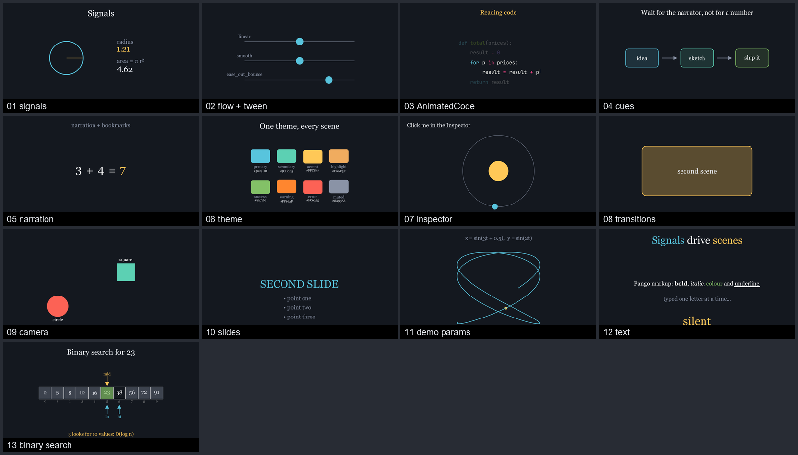

# Feature lessons: one lesson per feature

- **Status:** Available (`12_text.py Formula` needs LaTeX: tested only where LaTeX is installed)
- **Since:** PR #42
- **Source:** [`examples/lessons/`](../../../examples/lessons/) · **Tests:** `tests/test_lessons.py`



`examples/lessons/` holds thirteen short lessons, one per main feature. Each one shows how to **use** the feature and how to **animate** with it, then lists what to try in the Studio. Most lessons rebuild an idea from the [Manim example gallery](https://docs.manim.community/en/stable/examples.html) or the [Motion Canvas guides](https://motion-canvas.io/docs/) (pinned `v3.17.2`), using manim-stage's Python APIs on Manim primitives. Ideas are described in our own words; no Motion Canvas code is copied.

All lessons share one project theme, `examples/lessons/.manim-stage/project.json` (dark background, `speed` variable).

## Run them

```bash
cd examples/lessons
manim-stage studio 01_signals.py RadiusSignal       # any lesson, any scene
manim -qh 02_flow.py Tweening                        # plain Manim renders them too (1080p60)
manim-stage compose lessons.sequence.json -q low_quality   # lessons 08, 06, 10 joined
```

## The lessons

| # | Scenes | You learn | Based on | Feature page |
|---|---|---|---|---|
| 01 | `RadiusSignal`, `ArgMin` | One `Signal` drives a circle's size, colour and readouts; `computed` values; `bind` without hand-written updaters | MC *Signals*; Manim `ArgMinExample` | [Signals](../manim-stage/signals.md) |
| 02 | `FlowHelpers`, `Tweening` | `sequence`, `chain`, `all_of`, `delay`, `loop`; `tween` with `linear`, `smooth`, a bounce, and a custom stepped timing function | MC *Animation flow*, *Tweening* | [Flow helpers](../manim-stage/transitions.md) |
| 03 | `CodeTour` | Highlight lines, `Circumscribe` a range, box a selection, `animate_to` a refactor, `replace` a token | MC *Code* guides | [AnimatedCode](../manim-stage/animated-code.md) |
| 04 | `TimeEvents` | `self.cue(name, at=…)` and `after=…`; drag cues instead of editing waits | MC *Time Events* | [Named cues](../manim-stage/cues.md) |
| 05 | `Narrated`, `SoundEffects` | `self.narration(...)` with `<bookmark/>` cues; Manim `add_sound` with `time_offset` | manim-voiceover; MC *Media* | [Narration](../manim-stage/narration.md), [Audio](../manim-stage/audio.md) |
| 06 | `ThemePalette` | Every theme role as a swatch; the `speed` variable scales pacing | MC *Project variables* | [Project theme](../manim-stage/project.md) |
| 07 | `Orbit` | `self.expose(...)` the sun, planet and title; edit, save, copy as Python | MC inspector | [Inspector](../manim-stage/inspector.md) |
| 08 | `FirstScene`, `SecondScene` | `enter(self, "zoom")`, `enter(self, "slide", LEFT)`, `exit(self, "fade")`; join scenes with `lessons.sequence.json` | MC *Transitions* | [Transitions](../manim-stage/transitions.md#quick-start-joining-scenes) |
| 09 | `CenterOn`, `FollowDot` | `MovingCameraScene` + `StageMixin`: zoom to a shape, move, `Restore`; a camera that follows a dot | MC *Camera*; Manim `FollowingGraphCamera` | [Camera-aware preview](../manim-stage/camera.md) |
| 10 | `Slides` | `next_section` as slides; a skipped section; web player chapters | MC *Presentation* | [Sections](../manim-stage/sections.md), [Web player](../manim-stage/web-player.md) |
| 11 | `Lissajous` | `demo.param` sliders, a colour, a check box; live re-render | Manim `PointWithTrace`, `SineCurveUnitCircle` | [Demo parameters](../manim-stage/demo-params.md) |
| 12 | `Typography`, `Formula` | `Text` with `t2c`, `MarkupText`, `AddTextLetterByLetter`, `TransformMatchingShapes`; `MathTex` with a moving box and `TransformMatchingTex` | Manim text examples, `MovingFrameBox`; MC *LaTeX* | [Text and LaTeX](../manim-stage/text-latex.md) |
| 13 | `BinarySearch` | Record the search in a `Trace`, replay it on an `Array` with `lo`/`mid`/`hi` pointers; `target` is a demo parameter | algorithm lessons | [Educational helpers](../manim-stage/edu.md) |

## What a lesson looks like

The search runs first, as plain Python, and records its steps. The scene then replays them, one `self.play` per step:

```python no-run
def binary_search(values, target):
    trace, lo, hi = Trace(), 0, len(values) - 1
    while lo <= hi:
        mid = (lo + hi) // 2
        trace.step("look", lo=lo, mid=mid, hi=hi, value=values[mid])
        ...

play_trace(self, trace, {
    "look": lambda e: [mid.move_to_index(e["mid"]), lo.move_to_index(e["lo"]), ...],
    "found": lambda e: arr.highlight(e["mid"], theme.success, 0.7),
}, run_time=0.7)
```

## Differences from the originals

- **Camera rotation (MC *Camera*):** left out. A Manim `MovingCameraScene` frame pans and zooms but doesn't rotate.
- **Slides (MC *Presentation*):** sections don't pause playback the way MC's presentation mode does. They become chapters in the [web player](../manim-stage/web-player.md) and entries in the Studio's Sections tab.
- **Time events (MC *Time Events*):** in manim-stage, Shift-drag ripples later cues; a plain drag moves one cue. Motion Canvas does the opposite.
- **Narration:** the placeholder audio is synthetic and speech-like. Replace `narration_lesson.wav` with a real recording; the bookmark cues then need dragging to the words.

## Related

- [Themed multi-scene lesson](multi-scene-lesson.md) and [narrated bubble sort](narrated-bubble-sort.md): longer, end-to-end tutorials.
- [Motion Canvas equivalents](../reference/motion-canvas-equivalents.md#motion-canvas-guides-as-lessons): each MC guide and its lesson.
