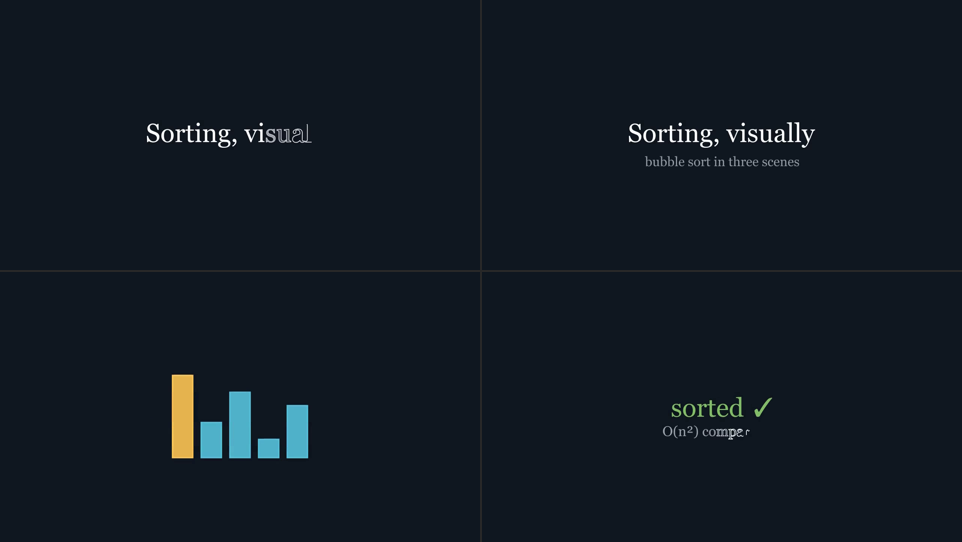

# Tutorial: a themed multi-scene lesson

- **Status:** Available (the M3 end-to-end demo)
- **Since:** PR #31
- **Spec:** §11 M3 gate, F06, F07, F08, F09, F10 · **Source:** `examples/lesson_series/`



`examples/lesson_series/` is one lesson made of three scenes (`Intro`, `Bars`, `Outro`) joined into one video. Everything visual comes from the project, so you restyle the whole lesson without touching the scenes.

## The pieces

| Feature | In the example | Page |
|---|---|---|
| Project theme | `project.theme()` colours every scene; background `#0F1720` | [Project](../manim-stage/project.md) |
| Project variable | `project.var("speed", 1.0)` scales all pacing | [Project](../manim-stage/project.md) |
| Signals | `Signal([5, 2, 4, 1, 3])` drives bar heights; `computed` picks the largest, drawn in the accent colour | [Signals](../manim-stage/signals.md) |
| Flow helpers | `sequence(0.15, ...)` creates the bars; `chain(...)` writes title then subtitle | [Transitions](../manim-stage/transitions.md) |
| Exposed property | `self.expose(title, "title", "color")`, editable in the Inspector | [Inspector](../manim-stage/inspector.md) |
| Scene transitions | `lesson.sequence.json`: fade into `Bars`, slide into `Outro` | [Transitions](../manim-stage/transitions.md#quick-start-joining-scenes) |
| Asset check | `manim-stage assets lesson.py` | [Assets](../manim-stage/assets.md) |

## Build it

```bash
cd examples/lesson_series
manim-stage assets lesson.py                          # nothing missing
manim-stage compose lesson.sequence.json -q low_quality
manim-stage studio lesson.py Bars                     # preview one scene, edit the theme
```

## Restyle it

1. In the Studio's **Project** tab, change *accent* and *speed*, then **Apply**, or edit `.manim-stage/project.json` directly.
2. In the **Inspector**, pick the title in `Intro`, change its colour, then **Save**.
3. Run `manim-stage compose lesson.sequence.json` again. All three scenes follow, and no `.py` file changed.

`tests/test_m3_gate.py` does exactly this. It also checks that two exports of the same project decode to identical pixels.

## Related

- [Narrated bubble sort](narrated-bubble-sort.md) (cues, narration, AnimatedCode).
