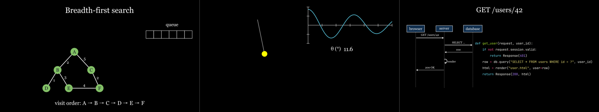

# Third-party-style examples (M4 gate)

Written the way an outside user would write them: plain Manim plus manim-stage's public API, with no internals. Each folder is self-contained. `tests/test_third_party_examples.py` renders all three in CI.

| Example | Shows | Run |
|---|---|---|
| [`graph_search/`](graph_search/) | BFS recorded as a `Trace` and replayed; Manim `Graph` laid out with `tree_layout`; `label_edges`; an `Array` queue; cues and sections | `manim-stage studio graph_search/bfs.py BFS` |
| [`pendulum/`](pendulum/) | Physics computed first, then played through a `Signal`; `computed` and `bind` (no hand-written updaters); `demo.param` sliders; project theme | `manim-stage studio pendulum/pendulum.py Pendulum` |
| [`http_request/`](http_request/) | `SequenceDiagram` with the `AnimatedCode` handler it runs, highlighted line by line; sections as web-player chapters | `manim-stage web http_request/request.py Request -q medium_quality` |

